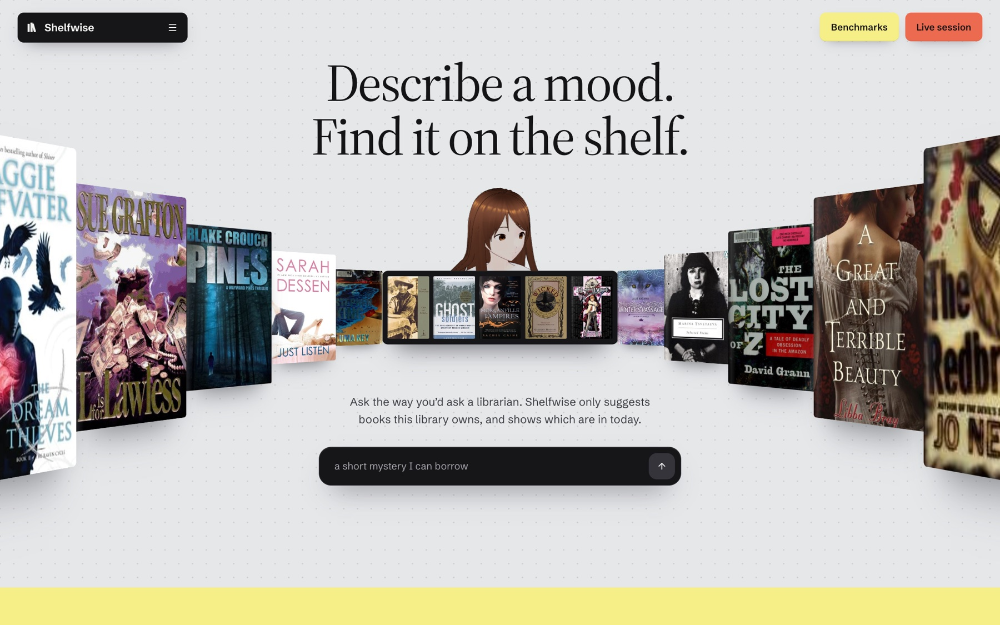
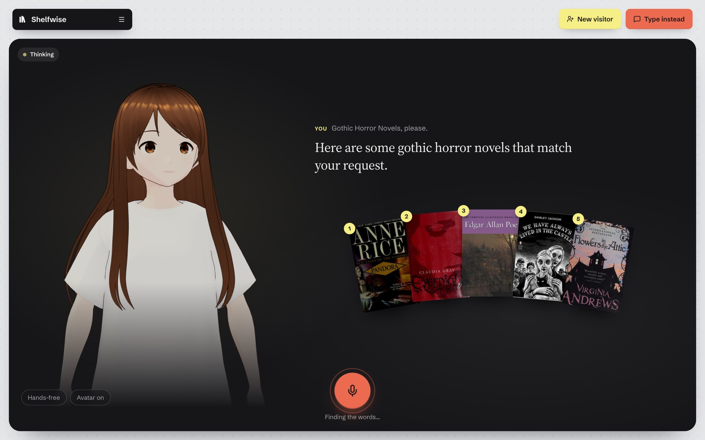
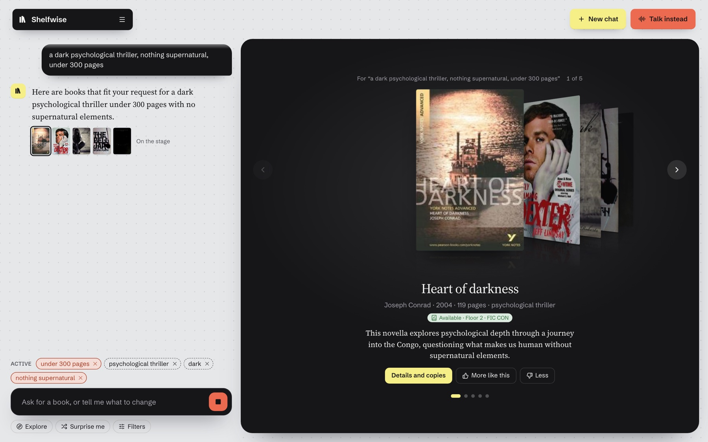
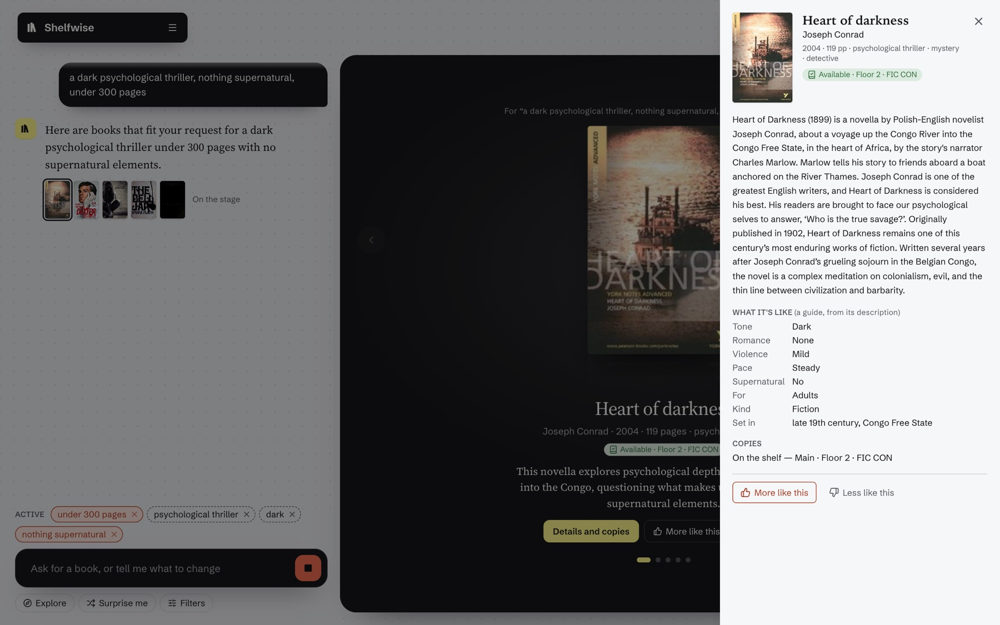
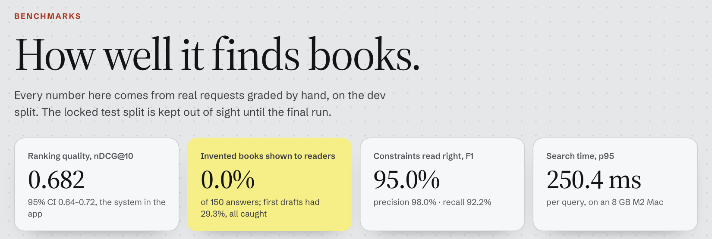
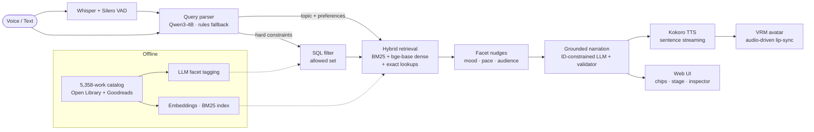

<div align="center">

# Shelfwise

### Describe a mood. Find it on the shelf.

**A conversational, voice-first library assistant with a talking avatar.**<br>
Hybrid retrieval, an LLM query parser, and grounded generation that **cannot invent a book**, all running locally on an 8 GB laptop.




</div>

<table>
<tr>
<td align="center" width="20%"><h2>0%</h2>invented books across<br><b>150 adversarial cases</b><br><sub>naive RAG: 21%</sub></td>
<td align="center" width="20%"><h2>2.2×</h2>better ranking on<br><b>"not" requests</b><br><sub>nDCG@10 0.56 vs 0.26</sub></td>
<td align="center" width="20%"><h2>95%</h2>F1 reading<br><b>constraints</b> from requests<br><sub>98% precision</sub></td>
<td align="center" width="20%"><h2>0.687</h2>nDCG@10 on the<br><b>locked test split</b><br><sub>+14% over hybrid search</sub></td>
<td align="center" width="20%"><h2>4 ms</h2><b>lip-sync</b> offset<br>at 59 fps<br><sub>median, measured in-browser</sub></td>
</tr>
</table>

---

## What it does

Ask for *"a dark psychological thriller, nothing supernatural, under 300 pages, on the shelf today"*, by typing or out loud. Shelfwise answers with books the library actually owns, says which floor and shelf they're on, and explains each pick, while an animated avatar speaks the answer.

| | |
| --- | --- |
| **Understands the whole request** | An LLM parser (Qwen3-4B with a deterministic rules fallback) splits a request into hard constraints (page limits, availability, exclusions), soft preferences (mood, pace, audience) and a topic. Each one appears as a chip the reader can drop, or toggle between *must* and *preferred*. |
| **Never breaks a hard constraint** | Constraints compile into a single SQL query that defines the allowed set, and every retrieval channel scores only inside it. A filter is a guarantee, not a hint. |
| **Gets "not" right** | Every book is tagged offline by an LLM for romance, violence, darkness, pace, the supernatural, audience and more. "Without the romance" becomes a filter, not a vector that drifts *towards* romance. |
| **Can't hallucinate** | The narrator's output schema accepts only the IDs of books retrieval returned. Titles, authors and availability come from the database, and a validator checks every sentence before it is shown or spoken. |
| **Holds a conversation** | "Shorter", "not so dark", "something like the second one", "only ones I can borrow today" refine the running request. A new topic starts fresh, and undo restores the last state. |
| **Talks back** | Whisper large-v3-turbo listens, Silero VAD detects end of speech, and Kokoro speaks. The first sentence plays while the LLM is still writing the rest, and speaking over it interrupts it (barge-in). |
| **Has a face** | A VRM avatar with procedural idle motion, blinking and gaze. Its lips are driven by the audio as it plays, so the voice and the mouth can't drift apart. |
| **Shows its work** | `/bench` renders the leaderboard with confidence intervals, the quality/latency trade-off, per-category scores, grounding results and voice timings. The chat inspector exposes the parse and the candidates at every stage. |

<table>
<tr>
<td width="50%"></td>
<td width="50%"></td>
</tr>
<tr>
<td align="center"><sub>Live session: ask out loud, the avatar answers with numbered picks</sub></td>
<td align="center"><sub>Chat: every constraint becomes a chip; the top pick shows where it is shelved</sub></td>
</tr>
<tr>
<td width="50%"></td>
<td width="50%"></td>
</tr>
<tr>
<td align="center"><sub>Book details: what it's like, and every copy's status and shelf</sub></td>
<td align="center"><sub><code>/bench</code>: every claim, measured</sub></td>
</tr>
</table>

---

## Architecture



<details>
<summary><b>Detailed diagrams</b></summary>


</details>

---

## Results

### Ranking quality: locked test split, run once

| System | nDCG@10 (95% CI) | Shelfwise's gain |
| --- | --- | --- |
| **Shelfwise** (parsed hybrid) | **0.687** (0.64–0.74) | — |
| Dense retrieval (bge-base) | 0.639 | **+7.5%** · paired bootstrap CI excludes zero |
| Hybrid BM25 + dense | 0.602 | **+14%** |
| BM25 | 0.436 | **+58%** |

Shelfwise's biggest wins are on the hardest requests:

| Request type | Shelfwise | Dense | |
| --- | --- | --- | --- |
| Negation ("without romance") | **0.56** | 0.26 | **2.2×** |
| Similarity ("like *Gone Girl*") | **0.64** | 0.48 | **+33%** |
| Vague ("something hopeful but quiet") | **0.63** | 0.52 | **+21%** |
| Availability ("on the shelf today") | **0.81** | 0.74 | **+9%** |
| Author | **0.88** | 0.84 | **+5%** |

### Everything else

| Capability | Result | Baseline |
| --- | --- | --- |
| Invented books shown to readers (150 adversarial cases, incl. prompt injection) | **0%** | naive RAG 21% · LLM alone 77% |
| LLM first drafts naming a book the library doesn't have, caught by the validator | **100%** caught before reaching a reader | 29.3% of first drafts |
| Top-10 books that break a "not" request (37 negation pairs) | **31%** | hybrid 62% · dense 67% |
| Constraint extraction F1 (184 gold parses) | **95.0%** (P 98.0%, R 92.2%) | — |
| Conversation state F1 (40 scripted sessions, 112 turns) | **80.4%** · turn type **95.4%** | rules alone 34.9% · 70.6% |
| LLM book tags vs human labels (200 books) | audience **96%** (κ 0.90) · fiction **100%** · supernatural **95%** | — |
| Search latency, p95 (5,358 works, all filters) | **~250 ms** | — |
| Avatar lip-sync offset (median) | **4 ms** · 59 fps · first frame in 0.73 s | no measurable added latency |

---

## Evaluation methodology

Every number above is reproducible from a JSON report in [`eval/reports/`](eval/reports/), named by timestamp and git commit.

- **Graded relevance with TREC-style pooling.** Every system's top 10 is pooled and graded 0–3 against a written rubric ([eval/GRADING.md](eval/GRADING.md)): **12,331 judgments** over 212 requests in eleven categories.
- **Inter-annotator agreement.** A human grades a blind sample independently: within one grade **90%** of the time, relevant/not κ 0.60–0.63, against a self-agreement ceiling of κ 0.76.
- **Leakage-proof splits.** Queries are split into dev and test by **paraphrase family**, so no rewording of a test request is ever seen during development. The test split is locked and was run exactly once.
- **Paired bootstrap confidence intervals** on every comparison, not just point estimates.
- **Adversarial grounding suite** ([set E](eval/README.md)): made-up titles, prompt injections in the message *and* in catalog text, checked-out books, and ordinary requests. Shelfwise is compared against naive RAG and an unconstrained LLM.
- **Four purpose-built test sets:** retrieval (A), gold parses (B), multi-turn conversations with the state checked after every turn (C), and grounding (E).
- **End-to-end voice measurement** in a real browser: timed from the last spoken word to the first word leaving the speakers, with the avatar on and off.
- **A negation study** with 1,679 labelled judgments: [docs/negation-study.md](docs/negation-study.md).

---

## Engineering

- **Strict static analysis:** pyright with 0 errors, ruff lint and format, all enforced by pre-commit hooks and **GitHub Actions CI** with unit and database integration jobs.
- **20k+ lines** of Python and TypeScript across a FastAPI backend, a React 19 frontend and the evaluation harness.
- **Postgres 16 + pgvector** schema managed with Alembic migrations; Redis-backed conversation sessions; an OpenAPI-typed client for the web app.
- **One-command workflows:** `make eval`, `make eval-grounding`, `make measure` and `make web-e2e` each rebuild their numbers from scratch.
- **Fully local and private:** no paid APIs and no data leaves the machine. The whole stack runs on an 8 GB M2 MacBook.

### Architecture decision records

1. [Filter first, then exact vector search in memory](docs/decisions/0001-filter-first-exact-search.md)
2. [Negation through LLM-extracted book facets](docs/decisions/0002-facets-for-negation.md)
3. [The LLM may only cite retrieved books](docs/decisions/0003-id-constrained-generation.md)
4. [Ollama with Qwen3-4B for the local LLM](docs/decisions/0004-ollama-local-llm.md)
5. [Lip-sync from the playing audio, in the browser](docs/decisions/0005-avatar-lip-sync.md)

---

## Tech stack

| Layer | Technology |
| --- | --- |
| **Retrieval** | bge-base-en-v1.5 embeddings, bm25s, pgvector, exact in-memory vector search over SQL-filtered sets |
| **Language** | Qwen3-4B via Ollama: query parsing, offline facet tagging, ID-constrained narration |
| **Speech** | Whisper large-v3-turbo (MLX 4-bit), Silero VAD, Kokoro-82M (ONNX) |
| **Backend** | Python 3.12, FastAPI, WebSockets, SQLAlchemy, Alembic, Postgres 16, Redis |
| **Frontend** | React 19, Vite, Tailwind 4, zustand, three.js + @pixiv/three-vrm |
| **Quality** | pytest, Hypothesis, Vitest, Playwright, pyright, ruff, GitHub Actions |

---

## Quickstart

Requires [uv](https://docs.astral.sh/uv/), Docker, [Ollama](https://ollama.com) and Node 24.

```bash
cp .env.example .env
make install             # Python 3.12 env + git hooks
make up                  # Postgres (pgvector) + Redis
make migrate             # the catalog schema
make import-seed         # the seed shelf from Open Library (~5 min first time, cached after)
make download-goodreads  # UCSD Book Graph subsets, ~1.6 GB (academic use only)
make build-catalog       # ~5,000 works from them (~10 min)
make simulate            # shelves, copies and 12 months of simulated loans
make embed               # embeddings for meaning-based search
make llm-pull            # the LLM (~2.5 GB); then `make llm` in its own terminal
make download-tts download-stt download-avatar   # voice and the avatar
make api                 # http://localhost:8000/api/v1/health
make web                 # http://localhost:5173 (another terminal)
```

Then `make test` (unit), `make test-all` (with the database), `make web-test`, `make web-e2e` (a real browser), `make eval` (the benchmark), `make measure` (the voice timings).

---

## Licences and credits

Book metadata is real (5,358 works from Open Library and the UCSD Goodreads Book Graph); shelves, copies and 12 months of loans are simulated. None of the data or models below are in this repository: the `make download-*` targets and the first run fetch them. Details and versions are in [CREDITS.md](CREDITS.md).

| Kind | What | Licence |
| --- | --- | --- |
| Data | UCSD Book Graph (Goodreads, 2017) | Academic use only; downloaded locally, never redistributed |
| Data | Open Library metadata | CC0 (public domain) |
| Data | Open Library covers | Publishers' images, shown as catalogue thumbnails under Open Library's terms |
| Embedding model | BAAI bge-base-en-v1.5 | MIT |
| Rerankers | cross-encoder/ms-marco-MiniLM-L6-v2, BAAI bge-reranker-base | Apache-2.0, MIT |
| LLM | Qwen3-4B (Mac), Qwen3-8B and 14B (offline data generation), via Ollama | Apache-2.0 |
| Speech to text | Whisper large-v3-turbo (MLX 4-bit conversion) | MIT |
| Voice activity | Silero VAD | MIT |
| Voice | Kokoro-82M, voice `af_heart` (kokoro-onnx export) | Apache-2.0 (model), MIT (kokoro-onnx) |
| Avatar | pixiv's VRM1_Constraint_Twist_Sample | VRM Public License 1.0 |
| Animation | None: idle motion, blinking, head turns and lip-sync are procedural | — |
| Fonts | Source Serif 4, Schibsted Grotesk | SIL Open Font License 1.1 |

**Data citation.** Mengting Wan and Julian McAuley, "Item Recommendation on Monotonic Behavior Chains", RecSys 2018; Mengting Wan, Rishabh Misra, Ndapa Nakashole and Julian McAuley, "Fine-Grained Spoiler Detection from Large-Scale Review Corpora", ACL 2019.
