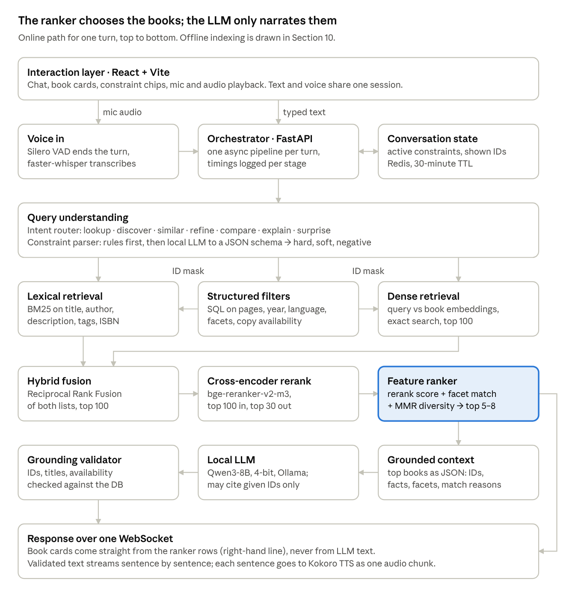
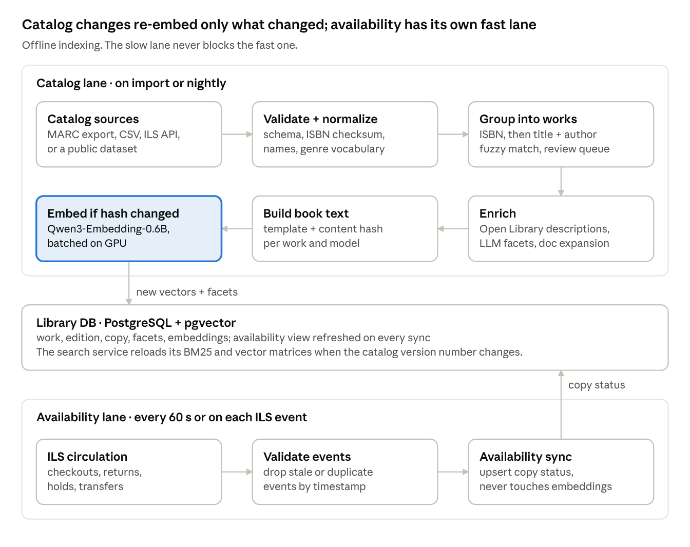
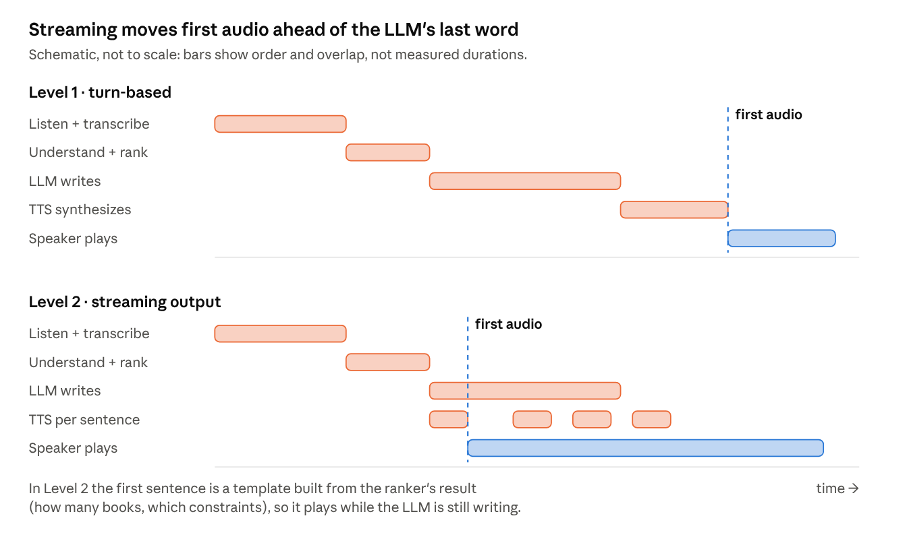
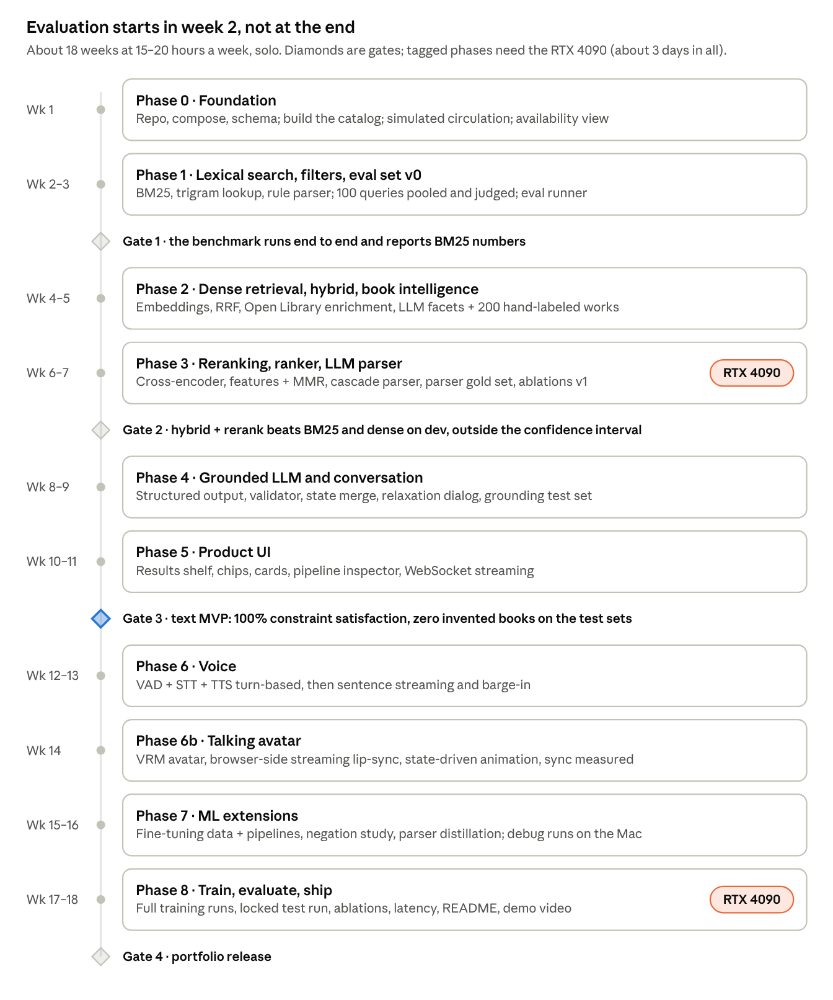
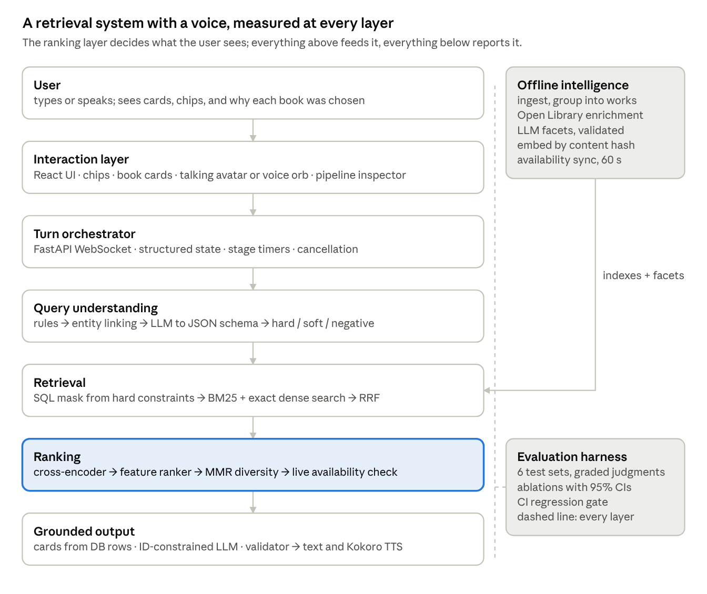

# Shelfwise — Library AI Assistant: System Design

Oct 6, 2026 · @Noor

> Snapshot of the living design doc on claude.ai: https://claude.ai/code/artifact/3957cf61-c5e3-4b63-b770-a0d9323a928d. The task checklist is [IMPLEMENTATION_PLAN.md](../IMPLEMENTATION_PLAN.md).

Status of every number in this document: **proposed targets or illustrative examples, not measured results.** Nothing has been built or benchmarked yet. "Shelfwise" is a working name.

## 1. Executive summary

Build a constraint-aware conversational retrieval and recommendation engine over a live library inventory, where the LLM narrates results it cannot invent. Voice is a first-class input/output channel on top, not the identity of the project.

**Recommended positioning:** *Shelfwise turns free-form requests ("dark, psychological, no supernatural, under 300 pages, on the shelf today") into verifiable, inventory-grounded recommendations, using hybrid retrieval, cross-encoder reranking, LLM-derived book facets and a local LLM that can only cite retrieved books.*

The five things that are genuinely hard here, and therefore the real contribution:

1. **Constraint parsing.** Separating hard constraints, soft preferences and negations in free text, and measuring that with F1.
2. **Negation and relative refinement.** Dense embeddings handle "not supernatural" and "something darker" badly. This design solves it with offline, LLM-extracted book facets (darkness, romance level, supernatural yes/no, pace) that become filterable and rankable fields.
3. **Hybrid retrieval under filters.** BM25 + dense + structured filters + reranking, with ablations proving each part pays for itself.
4. **Grounding by construction.** The LLM receives candidate IDs and may only reference them; a validator rejects anything else. Hallucinated-book rate is a reported metric.
5. **A latency budget on local hardware.** Time-to-first-audio is measured per pipeline stage, not described as "real-time".

**What this design cuts or challenges from the original brief:**

- **Learning-to-rank on clicks** is not possible without real users. Use a small feature-based ranker trained on your own relevance judgments instead, and say so.
- **Long-term personalization** cannot be evaluated without real user histories. Keep it session-level in the MVP.
- **The animated avatar and lip-sync** stay, but as a presentation layer: driven by the voice pipeline's state events, never allowed to delay audio, and measured (Section 21.4).
- **Full-duplex voice** is a stretch goal. Level 2 streaming (sentence-level TTS while the LLM is still generating) with simple barge-in is the realistic target.
- **The biggest practical risk is data quality, not models.** Real catalogs often have one-line descriptions. Enrichment (Section 10) is not optional.

## 2. Problem definition

Library catalogs (OPACs) answer "find the record matching these words". Readers ask "what should I read that fits this mood, these limits, and is on the shelf today?" The gap has three parts:

- **Vocabulary mismatch.** "Something disturbing but not supernatural" shares no keywords with the catalog records that satisfy it.
- **Mixed constraint types.** One sentence mixes hard filters (pages, year, availability), soft preferences (dark, twisty) and negations (no romance). Keyword search treats them all as words; vector search treats them all as vibes.
- **Ungrounded LLMs.** A general LLM will happily recommend books the library does not own, or claim a borrowed book is available.

**Problem statement:** given a natural-language request and a conversation history, return a ranked list of books that (a) exist in the inventory, (b) satisfy every hard constraint, (c) best match the soft preferences, and (d) are explained truthfully, within a latency budget suitable for spoken conversation.

## 3. Product vision

A reader walks up to a kiosk or opens a web page, says or types what they feel like reading, and gets five real books with shelf locations and an honest reason for each. They refine by talking ("shorter", "less romance") and the active constraints are always visible as chips they can remove. A librarian can trust it because it never invents availability.

Design principles, in priority order:

1. **Truth over fluency.** A correct "we don't have that" beats a fluent wrong answer.
2. **Visible state.** The user always sees which filters are active and why a book ranked.
3. **The ranker decides, the LLM explains.** The LLM never changes which books are shown.
4. **Every component earns its place with a number.** If an ablation shows no gain, the component goes.
5. **Local and private.** No paid APIs; audio never leaves the machine and is not stored.

## 4. User personas

| Persona | Goals | Pain points today | Typical queries | Preferred mode | What the system must do |
| --- | --- | --- | --- | --- | --- |
| Student (Ayesha, 20) | Find readable books for an assignment or a theme quickly | Catalog needs exact titles; shelves are disorganized by her topic | "Novels about colonialism under 250 pages" · "Something like 1984 for my essay" | Text, on phone | Theme search, page limits, availability, location |
| Casual reader (Bilal, 34) | Something good for the weekend | Doesn't know what he wants; staff are busy | "Surprise me" · "Something dark with a twist" | Text or voice | Vague-query handling, discovery, short explanations |
| Researcher (Dr. Khan) | Precise records: edition, year, publisher, copies | Fuzzy results waste time; needs certainty | "Do you have the 2nd edition of X?" · "Books by Y published after 2015" | Text + filters | Exact lookup, metadata accuracy, no paraphrased facts |
| Librarian (Sana) | Answer patron questions fast and correctly | Patrons ask in moods, catalog speaks in subjects | "Available psychological thrillers on floor 2" | Text + advanced filters | Inventory-exact availability, copy-level detail, trust |
| New visitor (Mr. Raza, 67) | Find something without learning the system | Typing on a kiosk is hard; catalog UI is confusing | "I liked Agatha Christie, what else do you have?" | Voice at a kiosk | Robust STT, spoken short answers, large visual cards |

## 5. Functional requirements

| ID | Requirement | Example | Release |
| --- | --- | --- | --- |
| F1 | Exact title / author / ISBN lookup with typo tolerance | "Do you have The Silent Patient?" | MVP |
| F2 | Semantic discovery from mood or theme | "Dark psychological thriller" | MVP |
| F3 | Multi-constraint search (pages, year, language, genre) | "Mystery under 300 pages after 2015" | MVP |
| F4 | Negative constraints | "Psychological but not supernatural" | MVP |
| F5 | Availability-aware results at copy level | "Only books I can borrow now" | MVP |
| F6 | Grounded natural-language response with per-book reasons | "Why it matches: …" | MVP |
| F7 | Conversational refinement over structured state | "Something shorter" | MVP |
| F8 | Item-to-item similarity | "Something like Gone Girl but less romance" | MVP |
| F9 | No-match handling with permission-based relaxation | "Nothing matches all 4 constraints; drop the year limit?" | MVP |
| F10 | Voice input and spoken output, shared state with text | Type then speak a follow-up | MVP (turn-based), V2 (streaming) |
| F11 | Explain a recommendation from ranking features | "Why did you recommend this?" | V2 |
| F12 | Compare 2–3 books | "Which of these is more psychological?" | V2 |
| F13 | Surprise-me discovery | "Surprise me" | V2 |
| F14 | Feedback (more / less like this) | Thumbs on a card | V2 |
| F15 | Librarian analytics: empty-result queries, demand by theme | Dashboard | V3 |

## 6. Non-functional requirements

These are **targets to measure against**, not results.

| Area | Target | How it is checked |
| --- | --- | --- |
| Retrieval latency (parse + retrieve + rerank, no LLM) | p95 under 300 ms on GPU, under 1 s on CPU | Benchmark harness, 500 queries |
| Text time-to-first-token | p50 under 1.0 s, p95 under 2.0 s | Server timestamps |
| Voice time-to-first-audio (end of speech to first audio) | p50 under 1.5 s, p95 under 2.5 s on the dev GPU | Voice benchmark, Section 21 |
| Invented books in responses | 0 shown to users (blocked by validator); raw LLM rate reported | Grounding test suite |
| Availability correctness | 100% match with copy table at response time | Integration tests |
| Hardware | One machine with an 8–12 GB NVIDIA GPU; CPU-only mode works, slower | Docker profiles |
| Privacy | Audio processed in memory and discarded; no accounts required for search | Code review + config |
| Catalog scale | 5k–50k titles without architecture change | Load test |
| Reproducibility | One command builds the index and runs the benchmark | CI job |

## 7. Existing systems and where this fits

Mood-based book discovery and LLM search assistants both exist. What is uncommon is combining **conversational constraint parsing, live copy-level availability, and grounding you can measure**, all running locally.

| System type | Examples | What it does well | Gap this project fills |
| --- | --- | --- | --- |
| Classic OPAC | Koha, Evergreen | Exact records, holdings, copy status | Keyword-only; no mood, negation or conversation |
| Discovery layers | Ex Libris Primo, EBSCO EDS, Summon | Relevance ranking, facets, large-scale indexing | Facet-driven, not conversational; commercial and closed |
| Reader platforms | Goodreads, The StoryGraph | Social signals; StoryGraph has mood and pace tags | Not tied to a specific library's shelves or availability |
| Generic RAG chatbot | LLM + vector store demos | Fluent answers | Ignores hard constraints, invents books, no evaluation |
| Voice receptionist | Reference project (SEECS AI Receptionist) | Voice-in/voice-out conversational front end | Q&A over documents, not ranked retrieval over structured inventory |

Honest takeaway: none of the individual techniques are new. The project is interesting because of the **combination, the constraint handling, and the measurement**.

## 8. System architecture

One FastAPI process runs a fixed, measurable pipeline per turn. The LLM sits near the end and cannot change which books appear: cards are rendered from database rows, and the LLM only writes the narrative around them.



Read it top to bottom: the parser turns words into constraints, filters shrink the candidate set first, two retrievers and a reranker order it, and only then does the LLM speak.

**What changed from the brief's diagram, and why:**

- **An intent router.** "Do you have X?" should not run dense retrieval and an LLM. Routing makes lookups faster and more precise.
- **Filters first, as an ID mask.** Filtering after ranking silently empties lists (top 20 retrieved, 0 under 300 pages). Filtering first guarantees every candidate is valid.
- **Availability placement depends on the user.** It is a hard filter only when the user asks for "available now"; otherwise it is a rank feature and a badge.
- **Cards bypass the LLM.** Titles, authors, shelf and status on screen are never generated text.
- **A validator between LLM and TTS.** Nothing is spoken until it passes. In streaming mode it checks each sentence.
- **State is structured.** The orchestrator stores constraints and shown IDs, not raw transcripts.

### Intent routing

| Intent | Example | Path through the pipeline |
| --- | --- | --- |
| lookup | "Do you have The Silent Patient?" | Trigram + BM25 on title/author/ISBN → copy status → templated answer. No dense, no rerank. |
| discover | "Dark psychological thriller" | Full pipeline |
| similar | "Like Gone Girl but less romance" | Seed book's embedding + facet deltas as the query → full pipeline, seed excluded |
| refine | "Something shorter" | Merge into state → full pipeline |
| compare | "Which is more psychological?" | No retrieval: facets of books already shown → LLM comparison |
| explain | "Why this one?" | Stored ranking features for that book → template + LLM phrasing |
| surprise | "Surprise me" | Discovery strategy (Section 15) |
| other | "Hi" · "What are your hours?" | Short reply or FAQ; no book retrieval |

### Components

| Component | Responsibility | Input | Output | Technology |
| --- | --- | --- | --- | --- |
| Interaction layer | Render chat, cards, chips; capture audio; play audio | User actions | WebSocket messages | React + Vite, Web Audio API |
| Voice in | Detect end of speech; transcribe | 16 kHz PCM frames | Transcript + confidence | Silero VAD, faster-whisper |
| Orchestrator | Run the turn, enforce timeouts, log stage timings | Turn event | Response stream | FastAPI, asyncio |
| Conversation state | Hold active constraints, shown and rejected IDs | Parsed delta | Merged state | Redis (dict in MVP) |
| Query understanding | Intent + constraints + semantic query text | Text + state | `SearchRequest` JSON | Rules, regex, Qwen3 via JSON schema |
| Structured filters | Hard and negative constraints as SQL | `SearchRequest` | Allowed book IDs | PostgreSQL |
| Lexical retrieval | Exact names, rare words, ISBN | Query text + mask | Ranked IDs + BM25 scores | bm25s in memory, pg\_trgm |
| Dense retrieval | Themes and moods | Semantic query + mask | Ranked IDs + cosine scores | Qwen3-Embedding-0.6B, NumPy / pgvector |
| Fusion | Merge ranked lists robustly | Two ranked lists | Top 100 | RRF |
| Reranker | Precise query–book relevance | Query + 100 book texts | Top 30 + scores | bge-reranker-v2-m3 |
| Feature ranker | Combine relevance, facets, popularity, diversity | 30 candidates + features | Top 5–8 + feature log | Weighted linear model, later LightGBM |
| Grounded context | Serialize facts the LLM may use | Top books | Compact JSON | Python |
| Local LLM | Explain, compare, converse | Context + state + user turn | Text with `[[book_id]]` tags | Qwen3-8B Q4\_K\_M on Ollama |
| Validator | Reject unknown IDs, wrong titles, wrong availability | LLM sentences | Pass / fix / fallback | Python + DB lookup |
| Voice out | Speak validated sentences | Sentences | Audio chunks | Kokoro-82M |

## 9. Data model

Use three levels, not two: **work** (the story, what you recommend), **edition** (an ISBN, with its own pages and year) and **copy** (a physical item on a shelf). Without the work level, "something like Gone Girl" returns three editions of the same novel.

```sql
CREATE EXTENSION IF NOT EXISTS vector;
CREATE EXTENSION IF NOT EXISTS pg_trgm;

-- WORK: what a reader means by "a book". Recommendation and embeddings live here.
CREATE TABLE work (
  work_id            BIGSERIAL PRIMARY KEY,
  title              TEXT NOT NULL,
  subtitle           TEXT,
  title_norm         TEXT NOT NULL,          -- casefolded, NFKC, articles stripped
  first_pub_year     INT,
  original_language  TEXT,                   -- ISO 639-1
  description        TEXT,
  description_source TEXT CHECK (description_source IN ('catalog','openlibrary','none')),
  genres             TEXT[] NOT NULL DEFAULT '{}',   -- controlled vocabulary, ~40 values
  themes             TEXT[] NOT NULL DEFAULT '{}',
  tags               TEXT[] NOT NULL DEFAULT '{}',
  popularity         REAL NOT NULL DEFAULT 0,        -- 0..1, from loan counts
  search_text        TEXT,                           -- the embedding input (Section 11)
  content_hash       TEXT,                           -- sha256(search_text)
  updated_at         TIMESTAMPTZ NOT NULL DEFAULT now()
);

CREATE TABLE author (
  author_id   BIGSERIAL PRIMARY KEY,
  display     TEXT NOT NULL,                  -- "Agatha Christie"
  name_norm   TEXT NOT NULL UNIQUE            -- "agatha christie"
);
CREATE TABLE work_author (
  work_id   BIGINT REFERENCES work ON DELETE CASCADE,
  author_id BIGINT REFERENCES author,
  role      TEXT NOT NULL DEFAULT 'author',  -- author | translator | editor
  position  SMALLINT NOT NULL DEFAULT 1,
  PRIMARY KEY (work_id, author_id, role)
);

-- EDITION: what the ISBN identifies. Page count and year belong here.
CREATE TABLE edition (
  edition_id    BIGSERIAL PRIMARY KEY,
  work_id       BIGINT NOT NULL REFERENCES work ON DELETE CASCADE,
  isbn13        CHAR(13) UNIQUE,              -- nullable: old books have none
  publisher     TEXT,
  pub_year      INT,
  edition_stmt  TEXT,                         -- "2nd ed."
  language      TEXT NOT NULL,
  pages         INT CHECK (pages > 0),
  format        TEXT                          -- hardcover | paperback | ebook
);

-- COPY: a physical item. Availability lives ONLY here. No borrower identity.
CREATE TYPE copy_status AS ENUM
  ('available','on_loan','on_hold','in_transit','reference_only','repair','lost');
CREATE TABLE copy (
  copy_id      BIGSERIAL PRIMARY KEY,
  edition_id   BIGINT NOT NULL REFERENCES edition ON DELETE CASCADE,
  barcode      TEXT NOT NULL UNIQUE,
  branch       TEXT NOT NULL,
  floor        TEXT,
  call_number  TEXT,                          -- shelf location, e.g. "823.914 MIC"
  status       copy_status NOT NULL,
  due_date     DATE,                          -- set when on_loan
  status_at    TIMESTAMPTZ NOT NULL           -- time of the ILS event, for ordering
);

-- Facets extracted offline (Section 11). Enable negation and "darker".
CREATE TABLE work_facets (
  work_id       BIGINT PRIMARY KEY REFERENCES work ON DELETE CASCADE,
  darkness      SMALLINT CHECK (darkness BETWEEN 0 AND 3),
  romance       SMALLINT CHECK (romance  BETWEEN 0 AND 3),
  violence      SMALLINT CHECK (violence BETWEEN 0 AND 3),
  pace          TEXT CHECK (pace IN ('slow','medium','fast')),
  supernatural  TEXT CHECK (supernatural IN ('yes','no','unclear')),
  audience      TEXT CHECK (audience IN ('children','ya','adult')),
  fiction       BOOLEAN,
  source        TEXT NOT NULL,                -- 'llm' | 'human'
  model_version TEXT,
  confidence    REAL
);

-- One row per (work, model): lets you A/B embedding models without migrations.
CREATE TABLE work_embedding (
  work_id      BIGINT REFERENCES work ON DELETE CASCADE,
  model_name   TEXT NOT NULL,
  content_hash TEXT NOT NULL,
  embedding    vector(1024) NOT NULL,         -- unit-normalized
  PRIMARY KEY (work_id, model_name)
);

-- Loans are separate and access-controlled. The assistant never reads this table.
CREATE TABLE loan (
  loan_id       BIGSERIAL PRIMARY KEY,
  copy_id       BIGINT REFERENCES copy,
  patron_hash   TEXT NOT NULL,                -- salted hash, not a name
  checkout_at   TIMESTAMPTZ NOT NULL,
  due_at        DATE NOT NULL,
  returned_at   TIMESTAMPTZ
);

CREATE INDEX ON work USING gin (title_norm gin_trgm_ops);
CREATE INDEX ON author USING gin (name_norm gin_trgm_ops);
CREATE INDEX ON work USING gin (genres);
CREATE INDEX ON copy (edition_id, status);
CREATE INDEX ON edition (work_id);
```

### How availability works

Availability is computed from copies, never stored on the work. A materialized view gives the ranker one row per work:

```sql
CREATE MATERIALIZED VIEW work_availability AS
SELECT e.work_id,
       count(*) FILTER (WHERE c.status = 'available')       AS available_copies,
       count(*) FILTER (WHERE c.status = 'reference_only')  AS reference_copies,
       count(*)                                             AS total_copies,
       min(c.due_date) FILTER (WHERE c.status = 'on_loan')  AS next_due,
       array_agg(DISTINCT c.branch) FILTER (WHERE c.status = 'available') AS branches_available
FROM edition e JOIN copy c USING (edition_id)
GROUP BY e.work_id;
-- REFRESH MATERIALIZED VIEW CONCURRENTLY after each sync batch (needs a unique index on work_id).
```

| Display state | Rule |
| --- | --- |
| Available | `available_copies >= 1` |
| In library only | `available_copies = 0` and `reference_copies >= 1` (read on site, cannot borrow) |
| Due soon | `available_copies = 0` and `next_due` within 7 days |
| Borrowed | `available_copies = 0` and `next_due` later than 7 days |
| Unavailable | No borrowable or reference copies (lost, repair) |

Two rules keep availability honest:

1. **Page-count and language filters apply per edition.** "Under 300 pages, available" means *some available copy of an edition with pages < 300*, not the work's shortest edition plus any available copy. The filter query joins edition and copy together.
2. **Re-read status at response time.** The view may be up to 60 s old. Before responding, the orchestrator re-reads `copy.status` for the 5–8 books being shown (one indexed query, about a millisecond).

## 10. Data pipeline

Two lanes: a slow catalog lane that may take minutes, and a fast availability lane that must never wait for it.



The accent marks the expensive step; content hashes ensure it runs only for works whose text actually changed.

### Where the data comes from

**Decided: we build and populate the catalog ourselves.** There is no export from the library's system, so the catalog is assembled from public metadata and circulation is simulated. The import path still accepts a real CSV or MARC export if one appears later.

| Source | When to use | Notes |
| --- | --- | --- |
| Real ILS export (Koha, Evergreen) as MARC21 or CSV | Best: real titles, real shelves | Parse MARC with `pymarc`. Descriptions are often missing; enrich. |
| UCSD Book Graph (Goodreads) | No real export available | Rich descriptions, shelves (proxy for genres), ratings for popularity. Academic-use terms; check before publishing data. |
| Open Library dumps / API | Enrichment of descriptions, subjects, covers | Free; respect rate limits; cache responses. |
| Simulated circulation | Always needed for a demo | Generate 1–4 copies per edition and a loan simulator weighted by popularity. **Label it simulated in the demo.** |

### Building the catalog ourselves

1. **Choose the slice:** 8,000–10,000 English works across 8–10 genres, taken from the UCSD Book Graph genre subsets (mystery/thriller/crime, fantasy/paranormal, romance, young adult, history/biography and others), keeping only works with a description, ISBN and page count. Respect its academic-use terms and do not republish the raw data.
2. **Fill gaps from Open Library** by ISBN: descriptions, subjects, covers, Dewey class where present. Cache every response.
3. **Add a real seed (recommended):** scan 100–300 real books from an actual shelf with a phone barcode app, look the ISBNs up on Open Library, and import them. A demo about books people can physically see is far more convincing.
4. **Generate the library layer:** one branch, floors by genre group, call numbers (fiction: `FIC` + first three letters of the author's surname; nonfiction: Dewey class when known), 1–4 copies per edition weighted by popularity, a few reference-only copies.
5. **Simulate circulation:** 12 months of seeded, reproducible loan events (popularity-weighted borrowing, 14-day loans, some late returns, holds). This produces current statuses, due dates and loan-count popularity. The UI footer says availability is simulated.
6. **Keep a manual path:** a CSV template and a small admin form for adding a book by ISBN.

A catalog of **5,000–20,000 works** is the sweet spot: large enough that retrieval quality matters, small enough to hand-label evaluation data.

### Pipeline steps

| Step | What it does | Tools | Failure policy |
| --- | --- | --- | --- |
| Schema validation | Typed record per row; reject malformed rows | Pydantic models | Rejected rows go to `ingest_errors` with a reason; pipeline continues |
| ISBN normalization | ISBN-10 → ISBN-13, checksum check | `isbnlib` | Bad checksum → ISBN set null, row kept, flagged |
| Text normalization | Unicode NFKC, whitespace, casefold for `*_norm` columns | Python stdlib | — |
| Author normalization | "Christie, Agatha" → "Agatha Christie"; strip dates "(1890-1976)" | Rules + `rapidfuzz` against known authors | Ambiguous → new author row, flagged |
| Genre normalization | Map raw subjects/shelves to \~40 controlled genres | Hand-written mapping dict; embedding nearest-neighbor suggestion for unmapped strings, human-approved | Unmapped → kept as tag only |
| Edition dedup | Same ISBN-13 → same edition | Exact key | Same ISBN, different titles → data-entry error, review queue |
| Work clustering | Same `title_norm` + primary author → same work; fuzzy match (token-set ratio ≥ 92 and same author) → candidate | `rapidfuzz` | Candidates go to a review CSV; never auto-merge fuzzy matches |
| Enrichment | Fill missing descriptions and subjects from Open Library by ISBN | `httpx` + on-disk cache | Still missing → `description_source='none'` |
| Facet extraction | LLM reads description + subjects, emits facets JSON | Ollama, JSON schema output | Invalid JSON twice → facets left null |
| Text build + hash | Render `search_text`, compute `content_hash` | Jinja template | — |
| Embedding | Embed works whose `(hash, model)` is new | sentence-transformers, batch 64 | Retry; never block the availability lane |
| Index publish | Bump `catalog_version`; search service reloads | One row in a `meta` table | Old index stays live until new one is complete (blue/green) |

### Missing values policy

- **Unknown page count fails a hard page filter.** The response says how many books were excluded for unknown length, e.g. "12 more have no page count recorded".
- **No description:** embed title + author + genres only and set a `low_info` flag. The ranker gives these a small penalty for vibe queries, none for lookups.
- **No year:** fails a hard year filter, same as pages.

### Incremental updates

- **Metadata edit** → rebuild `search_text` → new hash → re-embed that work only.
- **Copy status change** → availability lane only. Never re-embeds.
- **New embedding model** → embed everything into new `(work_id, model_name)` rows, run the benchmark, then flip the config. The old model stays as a fallback.
- **Facet prompt change** → bump `model_version`, re-extract in the background, compare against the human-labeled facet set before switching.

## 11. Book intelligence layer

This is the most underrated ML component in the design. It turns thin catalog records into three things the online system can use: a **search text** for embeddings, **structured facets** for filtering and ranking, and **expanded descriptions** that bridge the vocabulary gap.

### 11.1 One document per work, no chunking

Book descriptions are 50–400 tokens, well inside every candidate model's context. Chunking only adds aggregation problems. Chunk only if you later ingest long abstracts or tables of contents.

```text
Title: The Silent Patient
By: Alex Michaelides
Genres: psychological thriller; mystery
Themes: trauma; obsession; therapy; marriage
Mood: dark; tense; fast-paced                      <- from facets
About: Alicia Berenson's life is seemingly perfect... <- catalog or enriched
Readers say it feels like: a claustrophobic puzzle... <- doc expansion (optional, ablated)
```

Excluded on purpose: availability, shelf, copies, ISBN, publisher. They change often or carry no meaning, and would force re-embedding.

**Field weighting.** Repeating a field to "weight" it inside one embedding is a weak hack. Instead, weight by *channel*: title, author and ISBN are handled by BM25 and trigram lookup; meaning is handled by the embedding; facets are handled by filters and ranker features. The fusion and ranker weights (tuned, Section 14) are where weighting belongs.

### 11.2 LLM-extracted facets: the key to negation and "darker"

Embeddings cannot reliably represent "not supernatural": the word *supernatural* in the query pulls supernatural books *closer*. The fix is to turn such properties into fields once, offline:

```json
{"darkness": 3, "romance": 1, "violence": 2, "pace": "fast",
 "supernatural": "no", "audience": "adult", "fiction": true,
 "themes": ["trauma", "obsession", "therapy"]}
```

- Extracted by the same local LLM with a JSON schema and a short rubric per facet (what 0, 1, 2, 3 mean, with examples).
- `"unclear"` must be an allowed answer. Blurbs rarely reveal everything; forcing yes/no creates confident errors.
- **Validate it:** hand-label facets for 200 works, report per-facet accuracy and Cohen's kappa. Have a friend label 50 of them too; their agreement with you is the realistic ceiling.
- Negation then becomes a filter: `supernatural = 'yes'` is excluded; `'unclear'` is kept with a ranking penalty. "Darker" becomes `darkness > current median`.

This is a recognized pattern (LLM-based metadata enrichment), not a novel idea, but it is the single change most likely to fix the hardest demo queries, and its accuracy is measurable.

### 11.3 Document expansion (optional, ablated)

Generate 2–3 "reader-language" sentences and 5 likely search phrases per book offline, in the spirit of doc2query. Catalog text says "psychological suspense"; readers say "messes with your head". Keep it only if the ablation shows a gain, and check that expansions do not introduce plot claims that contradict the description.

### 11.4 Embedding model

Pick with your own benchmark, not the MTEB leaderboard. MTEB measures generic passages; your queries are moods and constraints. Model versions below are current to mid-2026; check for successors when you start.

| Model | Size | Dims | Languages | License | Role |
| --- | --- | --- | --- | --- | --- |
| `Qwen/Qwen3-Embedding-0.6B` | 0.6B | up to 1024 (Matryoshka) | 100+ | Apache-2.0 | **Primary.** Instruction-aware queries; can test 256/512/1024 dims |
| `BAAI/bge-m3` | 568M | 1024 | 100+ | MIT | Strong multilingual alternative; also gives sparse vectors |
| `BAAI/bge-base-en-v1.5` | 110M | 768 | English | MIT | **Fast baseline**; CPU-friendly |
| `intfloat/multilingual-e5-large-instruct` | 560M | 1024 | 100+ | MIT | Alternative to compare |
| `sentence-transformers/all-MiniLM-L6-v2` | 22M | 384 | English | Apache-2.0 | **Weak baseline**, to show the gap |

Practical notes:

- **Normalize to unit length** and use dot product. Use the model's query instruction (Qwen3: `Instruct: Given a reader's request, retrieve books that match it\nQuery: ...`). Documents get no instruction.
- **Storage:** 20,000 works × 1,024 dims × 4 bytes = 82 MB (41 MB in float16). It fits in RAM, which matters for Section 13.
- **Fine-tuning** the embedder on your labeled pairs (sentence-transformers, MultipleNegativesRankingLoss) is a legitimate V3 experiment. Do it only after the benchmark exists, and evaluate on held-out queries.

## 12. Query understanding

Use a cascade: deterministic rules for numbers, dates, ISBNs and availability; fuzzy entity linking for titles and authors; a local LLM with a JSON schema for everything fuzzy; then a validator that merges them. Rules are fast and never hallucinate numbers. The LLM handles language rules cannot.

### 12.1 Output contract

Every turn produces a `SearchRequest`, or a *delta* to the existing one for refinements.

```python
class Constraint(BaseModel):
    field: str                      # "pages", "pub_year", "genre", "facet.supernatural", "theme" ...
    op: Literal["eq","in","lt","lte","gt","gte","not_in","shift"]
    value: Any
    strength: Literal["hard","soft"]
    polarity: Literal["include","exclude"] = "include"
    source: Literal["rule","llm","chip","state"]
    span: str | None = None         # the words it came from, for UI chips + debugging

class SearchRequest(BaseModel):
    intent: Literal["lookup","discover","similar","refine","compare","explain","surprise","other"]
    semantic_query: str             # mood/theme text with negations and hard filters REMOVED
    lookup: LookupSpec | None       # title / author / isbn strings
    seed_work_ids: list[int] = []   # "like Gone Girl"
    constraints: list[Constraint] = []
    state_ops: list[Literal["keep","reset","remove:<field>"]] = ["keep"]
```

The brief's example becomes:

```json
{
  "intent": "discover",
  "semantic_query": "dark psychological murder mystery",
  "constraints": [
    {"field": "genre", "op": "in", "value": ["mystery","thriller"], "strength": "soft", "source": "llm"},
    {"field": "facet.darkness", "op": "gte", "value": 2, "strength": "soft", "source": "llm", "span": "dark"},
    {"field": "pages", "op": "lt", "value": 300, "strength": "hard", "source": "rule", "span": "under 300 pages"},
    {"field": "pub_year", "op": "gt", "value": 2010, "strength": "hard", "source": "rule", "span": "published after 2010"},
    {"field": "facet.supernatural", "op": "eq", "value": "yes", "polarity": "exclude", "strength": "hard", "source": "llm", "span": "no supernatural elements"},
    {"field": "available_now", "op": "eq", "value": true, "strength": "hard", "source": "rule", "span": "available now"}
  ]
}
```

Note that `semantic_query` drops "no supernatural". Leaving the negated word in the embedding query pulls supernatural books *closer*. This one detail fixes a whole class of failures.

### 12.2 The cascade

1. **Normalize.** Lowercase copy for matching, keep the original for display. Expand number words ("three hundred" → 300), which voice transcripts produce.
2. **Rules and regex.** About 30 patterns: page bounds ("under / fewer than / at most N pages"), years ("after 2015", "2010s", "recent" = last 5 years, soft), ISBN-10/13, availability phrases ("available", "right now", "today", "can borrow", "on the shelf"), language names, "by \<name>". Each match records its span.
3. **Entity linking.** Fuzzy-match n-grams against the title and author dictionaries (pg\_trgm or rapidfuzz). "Something like Gone Girl" → `seed_work_ids=[812]`. "Silent Pateint" → The Silent Patient with similarity 0.78.
4. **LLM extraction.** Qwen3 with a JSON schema (Ollama's `format` parameter), given the query, the current state summary, the controlled genre and facet vocabularies, and the rule matches as hints. It fills intent, soft preferences, negations, and refinement operations. Skipped for high-confidence lookups.
5. **Validate and merge.** Pydantic validation. **Rules win on numbers, dates and ISBNs;** the LLM wins on moods and themes. Free-text themes snap to the vocabulary by embedding similarity (above a tuned threshold), otherwise stay as soft text.
6. **Sanity checks.** Contradictions (min pages > max pages, year after 2030) and empty requests trigger a clarifying question instead of a search.

### 12.3 Approaches compared

| Approach | Good at | Bad at | Latency (estimate) | Role here |
| --- | --- | --- | --- | --- |
| Rules / regex | Numbers, dates, ISBN, availability words | Paraphrase, moods, negation scope | under 1 ms | First pass, authoritative for numbers |
| Classical NLP (spaCy NER, dependency parse) | Names, negation scope | Book-domain moods; needs training data | \~5 ms | Optional; not worth it next to the LLM |
| Fine-tuned small model (e.g. T5 / BERT tagger) | Fast, cheap once trained | Needs hundreds of labeled queries | \~10 ms | V3 experiment: distill the LLM parser |
| Local LLM, free text | Anything | Format errors, invented fields | 0.5–2 s | No |
| Local LLM + JSON schema | Moods, negation, refinements, intent | Numbers sometimes; latency | 0.3–1 s on GPU | Second pass |
| **Hybrid cascade** | All of the above | More code paths to test | dominated by the LLM call | **Recommended** |

All latencies are guesses to replace with measurements. The parser's output is evaluated directly (Section 28: per-field precision, recall and F1, plus exact-match rate).

### 12.4 Hard, soft and negative constraints

Each constraint carries a `strength`. The default comes from the constraint type, then linguistic cues adjust it, and the user can always override it by clicking a chip.

| Cue in the request | Default strength | Example | Effect |
| --- | --- | --- | --- |
| Explicit numeric bound | Hard | "under 300 pages" | SQL filter |
| Vague size or recency | Soft with a target | "short", "recent" | Ranker penalty: `max(0, pages - 250) / 250` |
| Availability words | Hard | "available now", "can borrow today" | SQL filter on copies |
| No availability words | Soft | (nothing said) | Rank feature + badge; available books gently preferred |
| Genre as head noun | Strong soft | "a mystery" | Large ranker weight; catalog genre labels are too incomplete to filter on |
| "only", "must", "strictly" | Promote to hard | "only mysteries" | Genre becomes a filter |
| "ideally", "maybe", "preferably" | Demote to soft | "ideally under 300" | Penalty instead of filter |
| Mood adjectives | Soft | "dark", "twisty" | Facet targets + semantic query |
| Negation that maps to a facet | Hard exclude | "no supernatural" | Exclude `supernatural='yes'`; penalize `'unclear'` |
| Negation with no facet | Soft penalty | "nothing with animal deaths" | Penalty = λ × similarity(book, "animal deaths") |
| Relative refinement | Shift relative to last results | "darker", "shorter" | `darkness > median of shown`; `pages < 0.75 × median shown` |

**How they flow into retrieval and ranking:**

- Hard include and hard exclude → SQL WHERE → the allowed-ID mask. Nothing outside the mask can ever be shown.
- Soft → the `semantic_query` text and ranker features.
- Soft exclude → penalty features. Be honest in the UI: "tried to avoid", not "excluded".

**When hard constraints return nothing**, relax only with permission and make the choice concrete. Compute counts with each hard constraint dropped (one cheap COUNT query each):

> No available mystery under 300 pages after 2015 matches. Dropping "after 2015" gives 7 options; dropping "available now" gives 4, the earliest due back Thursday. Which should I relax?

**"By a female author"** needs author gender data that catalogs rarely hold, and guessing gender from names is unreliable and disrespectful. Only support it if you import self-identified gender from a source such as Wikidata, label it as such, and say plainly when data is missing.

## 13. Hybrid information retrieval

At library scale (under \~100,000 works) the right design is **filter first, then exact scoring in memory**. Approximate nearest-neighbor indexes solve a problem you do not have and introduce one you do: filtered ANN search can return fewer than k results when filters are selective.

### 13.1 Why three channels

| Query | BM25 alone | Dense alone | Filters alone |
| --- | --- | --- | --- |
| "The Silent Patient" | Correct | Usually right, but may rank similar thrillers above it | Cannot |
| "9780525559474" | Correct | Fails: numbers carry no meaning in embeddings | Exact ISBN match works |
| "Books by Tana French" | Correct | Weak on names | Works if the author is linked |
| "Something that messes with your head" | Fails: vocabulary mismatch | Good | Cannot |
| "Psychological but not supernatural" | Matches "supernatural" positively | Pulled toward supernatural | Facet filter solves it |
| "Under 300 pages, available" | Ignores numbers | Ignores numbers | Exactly right |

No single channel covers the table. That table, filled with real measured numbers per query category, is the core argument for the architecture (Section 30).

### 13.2 How the channels interact

```python
def retrieve(req: SearchRequest, k: int = 100) -> list[Candidate]:
    # 1. Hard constraints -> allowed IDs (one SQL query joining work/edition/copy/facets)
    allowed = sql_filter(req.hard_constraints())          # np.ndarray of row indices
    if allowed.size == 0:
        return []                                         # triggers relaxation dialog

    # 2. Lexical: BM25 per field, restricted to allowed rows
    bm25_title  = BM25_TITLE.score(req.lexical_query())[allowed]
    bm25_body   = BM25_BODY.score(req.lexical_query())[allowed]
    lex_rank    = top_k(2.0 * bm25_title + bm25_body, k)   # weights tuned later

    # 3. Dense: exact dot product over the allowed slice of an in-memory matrix
    q = embed_query(req.semantic_query)                   # cached by text
    if req.seed_work_ids:
        q = normalize(q + mean(EMB[req.seed_work_ids]))    # "like X" blends seed + text
    dense_rank  = top_k(EMB[allowed] @ q, k)              # 20k x 1024: a few ms

    # 4. Fuse (Section 14), keeping raw scores as ranker features
    return rrf_fuse([lex_rank, dense_rank], k=60)[:k]
```

Design notes:

- **One SQL query builds the mask** and joins edition and copy so per-edition rules hold (Section 9).
- **BM25 lives in memory** via the `bm25s` library: real BM25, about a second to rebuild for 20k works, zero infrastructure. PostgreSQL's built-in `ts_rank` is not BM25 and ranks noticeably differently; ParadeDB's `pg_search` is the upgrade path if you want BM25 inside Postgres.
- **Typo-tolerant lookups** use `pg_trgm` similarity on `title_norm` and `author.name_norm`.
- **The vector matrix lives in memory**, loaded from `work_embedding` at startup and on `catalog_version` change. pgvector remains the source of truth and the scale path (HNSW with iterative scans) if the catalog grows past \~500k.
- **Lexical query text** keeps names and rare words; the semantic query keeps moods and themes. They are different strings on purpose.
- **Lookup intent short-circuits**: trigram + BM25 title match above a threshold returns that work directly, plus near-duplicates ("did you mean the 2019 or the 2021 edition?").

## 14. Ranking and reranking

Three stages, each cheaper per item than the next is accurate: rank fusion over \~200 candidates, a cross-encoder over the top 100, a feature ranker over the top 30. Every weight starts from a stated default and is then tuned on a validation split, never on the test split.

### 14.1 Fusion methods

| Method | Formula | Use when | Weakness |
| --- | --- | --- | --- |
| Reciprocal Rank Fusion | score(d) = Σᵢ 1 / (k + rankᵢ(d)), k = 60 | Default. Scores from BM25 and cosine are not comparable; ranks are | Ignores how confident each channel is |
| Weighted RRF | score(d) = Σᵢ wᵢ / (k + rankᵢ(d)) | One channel is clearly better for a query type | Weights must be tuned |
| Normalized score fusion | α · z(dense) + (1 − α) · z(bm25) | Score magnitudes carry signal (a perfect title match) | Sensitive to score distributions; per-query normalization needed |
| Learned | Raw scores as ranker features | You have labeled data | Needs labels; can overfit |

The recommended RRF, in display form:

```latex
\mathrm{RRF}(d) = \sum_{i \in \{\text{bm25},\,\text{dense}\}} \frac{w_i}{k + \mathrm{rank}_i(d)}
```

**Tuning protocol (no invented weights):**

1. Start with plain RRF, k = 60, equal weights. This is the literature default (Cormack et al., 2009) and your hybrid baseline.
2. Grid-search on the validation split: w\_bm25 and w\_dense in {0.5, 1, 1.5, 2}, k in {10, 30, 60}; also α in steps of 0.1 for normalized fusion.
3. Select by NDCG@10 on validation. Report the chosen setting and its test score once.
4. Report per query category. It is normal for BM25 to win on lookups and dense to win on moods; a per-intent weight set is legitimate if the intent router decides it.

### 14.2 Cross-encoder reranking

A bi-encoder embeds the query and the book separately, so it cannot model how specific query words interact with specific book words. A cross-encoder reads both together and scores the pair. It is far more accurate per pair and far too slow to run over the whole catalog, hence retrieve-then-rerank.

| Model | Size | Languages | License | Use |
| --- | --- | --- | --- | --- |
| `BAAI/bge-reranker-v2-m3` | 568M | Multilingual | Apache-2.0 | **Primary**, GPU |
| `Qwen/Qwen3-Reranker-0.6B` | 0.6B | Multilingual | Apache-2.0 | Alternative to compare; LLM-style prompt format |
| `BAAI/bge-reranker-base` | 278M | English, Chinese | MIT | Middle ground |
| `cross-encoder/ms-marco-MiniLM-L6-v2` | 22M | English | Apache-2.0 | **CPU fallback** and fast baseline |

Engineering details:

- **Input:** the `semantic_query` (plus any title or author string) against `search_text` truncated to 384 tokens.
- **Batching:** all pairs in one fp16 batch, sorted by length to cut padding.
- **Candidate count is an experiment, not a guess.** Sweep N in {20, 50, 100, 200} and plot NDCG@10 against p95 rerank latency. The knee of that curve sets N. This chart is a strong portfolio exhibit.
- **Caching:** an LRU keyed by `(hash(semantic_query), work_id, model)`. Refinements like "available only" reuse every score, because they change filters, not the query.
- **Known limitation:** these rerankers were trained mostly on web-search relevance (MS MARCO-style). Mood matching may transfer poorly, and they handle negation as badly as embeddings. If the ablation shows the reranker helps lookups and topical queries but not mood queries, report that; an honest negative result is more credible than a uniform win.

## 15. Recommendation engine

The final ranker is a small, explicit model over named features, not cosine similarity. Being explicit is what makes "Why did you recommend this?" answerable from data rather than invented by the LLM.

### 15.1 Features

| Feature | Definition | Range |
| --- | --- | --- |
| `ce_score` | Sigmoid of cross-encoder logit | 0–1 |
| `rrf_score`, `bm25_title`, `bm25_body`, `dense_cos` | Retrieval scores, per-query min-max normalized | 0–1 |
| `facet_match` | Mean over requested facets of 1 − \|book − target\| / 3 | 0–1 |
| `genre_match` | Overlap of requested and book genres (Jaccard) | 0–1 |
| `soft_exclude_penalty` | Max similarity to any soft-excluded concept; `supernatural='unclear'` counts here | 0–1 |
| `size_penalty` | Distance past a soft page target, divided by target | 0+ |
| `availability` | 1 available, 0.6 in library only, 0.4 due within 7 days, 0 otherwise (only when availability is soft) | 0–1 |
| `popularity` | log(1 + loans in 12 months), normalized | 0–1 |
| `seed_sim` | Cosine to seed books for "like X" | −1–1 |
| `session_affinity` | Cosine to liked-this-session centroid minus disliked centroid | −1–1 |
| `seen_penalty` | 1 if already shown this session (unless asked again) | 0/1 |
| `low_info` | No description available | 0/1 |

### 15.2 Scoring, then diversifying

Relevance score is a weighted sum, s(d) = w · x(d). Then select the final list greedily with Maximal Marginal Relevance so five near-identical thrillers do not crowd out variety:

```latex
d^{*} = \arg\max_{d \in C \setminus S} \Big[ \lambda \, s(d) - (1 - \lambda) \max_{d' \in S} \cos(e_d, e_{d'}) \Big]
```

Plus two business rules: at most 2 books per author and 1 per series in a single response, unless the user asked for that author or series. λ starts at 0.7 and is chosen by plotting NDCG@5 against intra-list diversity on validation.

### 15.3 Which ranking approach

| Approach | What it learns from | Realistic here? |
| --- | --- | --- |
| Heuristic linear (hand weights) | Your judgment | **Yes, MVP.** Transparent, debuggable |
| Tuned linear | Grid search or logistic regression on graded labels | **Yes, MVP+.** Weights become evidence-based |
| Pointwise learned (regression on labels) | Each (query, book) label alone | Possible; ignores that ranking is relative |
| Pairwise / listwise LTR (LightGBM LambdaRank) | Which book should beat which, per query | **Yes, V2**, on your judged set (\~150 queries × \~40 pooled books). Cross-validate by query family |
| LTR on clicks | Real user behavior | **No.** You will not have enough users. Do not claim it |
| Reinforcement learning / bandits | Online rewards | No. No traffic to learn from |

The honest portfolio claim: *"a LambdaMART ranker trained on 6,000 hand-graded query–book judgments, compared against a tuned linear ranker"*, whatever the result turns out to be. **Leakage warning:** paraphrases of one query must all land in the same fold, or the test score is inflated.

### 15.4 Explanations come from features

Store each shown book's feature vector and the matched constraint spans. "Why this?" renders the top contributing features into a template, and the LLM only rephrases it:

```text
Matched: psychological (theme), dark (darkness 3/3), under 300 pages (262)
Less strong: published 2012 (you asked after 2010, fine)
Available: 2 copies, Floor 2, 823.92 FLY
```

### 15.5 "Surprise me"

Return three labeled picks instead of one random book: a **safe** pick, a **stretch** and a **wildcard**. Randomness without structure is just noise; this gives the reader a choice of how adventurous to be.

1. **Pool:** available now (a surprise you cannot borrow disappoints), has a description, popularity above the 30th percentile as a quality floor.
2. **Taste anchor:** the session's liked centroid or stated preferences; if none, the pool's popular-and-recent region.
3. **Clusters:** k-means (\~30 clusters) over work embeddings, computed offline. Track which clusters this session has already seen.
4. **Safe:** high similarity to the anchor, not yet shown. **Stretch:** a cluster adjacent to the anchor, similarity in a middle band (about 0.3–0.6). **Wildcard:** an unseen cluster, highest quality inside it.
5. **Sample, don't argmax:** softmax sampling over each slot's top 10 (temperature tuned), so pressing it twice gives different books.

Measure: intra-list diversity, novelty (mean self-information, −log₂ of popularity share), catalog coverage over 1,000 simulated presses, and a small rating study (5–10 people, "would you read this?" 1–5). Report the study size honestly.

## 16. Personalization

Ship **session-level** personalization only in the MVP. Long-term profiles need real users to evaluate and raise privacy questions; build them only behind an opt-in in V2.

| Layer | Signal | Mechanism | Release |
| --- | --- | --- | --- |
| Session explicit | "I don't like romance" | Persistent soft negative constraint in state | MVP |
| Session feedback | More like this / less like this, thumbs | Rocchio-style update of the query vector (below) + `session_affinity` | MVP |
| Session implicit | Opened details, ignored a card | Small `session_affinity` weight; ignored = weak negative | V2 |
| Long-term explicit | Saved favorite genres, authors, dislikes | Profile constraints merged at session start, shown as chips | V2, opt-in |
| Long-term implicit | Borrowing history | User embedding = recency-weighted mean of borrowed works | V3, opt-in |
| Collaborative | Co-borrowing across patrons | Item–item co-occurrence or implicit ALS | V3, only with real or public interaction data |

Rocchio update, applied to the dense query on each feedback event:

```latex
q' = \alpha\, q + \beta\, \frac{1}{|L|} \sum_{d \in L} e_d - \gamma\, \frac{1}{|D|} \sum_{d \in D} e_d
```

where L and D are liked and disliked books. Defaults α = 1, β = 0.6, γ = 0.3, tuned with simulated sessions (Section 27).

- **Cold start** is not a problem for session-level personalization. Optionally offer three "what do you usually like?" chips on first visit.
- **Privacy:** patron reading records are confidential under standard library ethics. Long-term data is opt-in, viewable, deletable, stored as preferences rather than raw loan lists where possible, and never sent off the machine.
- **Evaluation:** session personalization can be tested with scripted multi-turn sessions. Long-term personalization can only be evaluated offline on a public interaction dataset (for example leave-last-out recall on Goodreads shelves), with the caveat that ratings are not borrowing.

## 17. Conversational memory

Memory is a typed state object, updated by deltas, not a growing transcript. The retrieval pipeline reads only the state; the LLM sees the state plus the last two or three turns for tone.

```python
class ConversationState(BaseModel):
    session_id: str
    last_active: datetime
    mode: Literal["text", "voice"]                # last input modality; display only
    constraints: list[Constraint]                  # active hard/soft/negative, each tagged with its turn
    semantic_query: str                            # current mood/theme text
    seed_work_ids: list[int]
    last_results: list[ShownBook]                  # ordered; resolves "the second one", "these"
    shown_ids: set[int]                            # novelty within session
    liked_ids: set[int]
    disliked_ids: set[int]
    declined_relaxations: list[str]                # don't offer the same relaxation twice
    recent_turns: deque[Turn]                      # maxlen=3, text only, for the LLM
```

**Merge rules:**

| User says | State operation |
| --- | --- |
| A constraint on a new field ("under 300 pages") | Add |
| A constraint on an existing field ("under 200" after "under 300") | Replace; later wins |
| A relative change ("darker", "shorter") | Shift computed from `last_results` (median darkness or pages) |
| "Forget the page limit" / removes a chip | Remove that field |
| "The second one" / "that one" | Resolve to `last_results[i]` before parsing anything else |
| A clearly new topic (low similarity to current query and no refinement cues) | Reset soft constraints and seeds; **keep** availability and language, which describe the user, not the topic; show "New search (kept: available now)" with an undo |
| "Start over" | Full reset |

**Worked example:**

| Turn | User | Active constraints afterward |
| --- | --- | --- |
| 1 | "Give me psychological thrillers" | genre≈thriller (soft), theme=psychological (soft) |
| 2 | "Something darker" | + darkness > 2 (soft; the median of turn 1's results was 2) |
| 3 | "I don't want anything supernatural" | + supernatural ≠ yes (hard exclude) |
| 4 | (spoken) "Under three hundred pages" | + pages < 300 (hard) |
| 5 | "Tell me more about the second one" | unchanged; intent=explain, target=`last_results[1]` |

**Expiry and privacy:**

- Web sessions expire after 30 minutes idle (Redis TTL).
- **Kiosk mode** resets after 2 minutes idle and has a visible "New visitor" button. A shared kiosk must never show the previous person's conversation.
- Raw turn text lives only in `recent_turns` (3 turns) and dies with the session. Logs keep parsed requests and timings, with free text off by default.
- No summarization model is needed. The structured state *is* the summary, and it is inspectable, testable and cheap.

## 18. Grounded local LLM

The LLM has four jobs: parse fuzzy requests into JSON (Section 12), write a short reason per book, compare books already shown, and hold a natural tone. It never chooses books, never states availability on its own, and never produces titles: code inserts those from the database.

### 18.1 Model and runtime

Model names are current to mid-2026. The rule that outlives them: **choose an \~8B instruct model with reliable JSON-schema output, and let your benchmark decide** (parser F1, grounding failures, time-to-first-token).

| Model | Quantized size (approx.) | License | Fit |
| --- | --- | --- | --- |
| **Qwen3-8B**, Q4\_K\_M | \~5 GB | Apache-2.0 | **Recommended.** Strong structured output, multilingual. Disable thinking mode for latency |
| Qwen3-4B, Q4\_K\_M | \~2.5 GB | Apache-2.0 | 8 GB GPUs; also a candidate for the latency-critical parser |
| Llama 3.1 8B Instruct | \~5 GB | Llama Community License | Solid alternative |
| Gemma 3 12B | \~8 GB | Gemma Terms of Use | Better prose, tighter VRAM next to STT/TTS/reranker |
| Mistral Small 3.x 24B | \~14 GB | Apache-2.0 | Too large to co-host with the rest on 12 GB |
| Phi-4-mini (3.8B) | \~2.5 GB | MIT | CPU-only fallback |

**VRAM budget on a 12 GB GPU** (estimates; confirm with `nvidia-smi` under load): LLM 8B Q4 with 8k context about 6.5 GB, embedder about 1.3 GB, reranker about 1.2 GB, faster-whisper large-v3-turbo (int8\_float16) about 1.5 GB, Kokoro about 0.5 GB. Roughly 11 GB: it fits, without much headroom. On 8 GB, drop to Qwen3-4B and a smaller Whisper.

| Runtime | Strengths | Weaknesses | Verdict |
| --- | --- | --- | --- |
| **Ollama** | One command; JSON-schema `format`; streaming; model keep-alive; OpenAI-compatible API | Less control over batching and sampling internals | **Use it** |
| llama.cpp server | GBNF grammars, fine-grained control, CPU and GPU | More setup | Fallback if you need grammar tricks |
| vLLM | Throughput, many concurrent users | Linux, more VRAM, little gain for one user | Not needed |
| HF Transformers | Full control | Slow, no quantization convenience | Only for experiments |

### 18.2 Structured generation, not free text

Ask for JSON whose book references are an **enum of the candidate IDs**. The model physically cannot reference a book outside the list, because constrained decoding rejects any other token sequence.

```json
{
  "type": "object",
  "properties": {
    "intro":     {"type": "string", "maxLength": 200},
    "items": {"type": "array", "maxItems": 5, "items": {
        "type": "object",
        "properties": {
          "work_id": {"enum": [812, 1033, 77, 2410, 3156]},
          "why":     {"type": "string", "maxLength": 220}
        },
        "required": ["work_id", "why"]}},
    "follow_up": {"type": "string", "maxLength": 120}
  },
  "required": ["intro", "items"]
}
```

Code then renders each item as **title and author from the DB** + the model's `why` + availability **from the DB**. For voice, a streaming partial-JSON parser emits each `why` as soon as its closing quote arrives, so TTS can start on item one while item three is still generating.

Context given to the model, per candidate (compact, about 120 tokens each):

```json
{"work_id": 812, "title": "The Silent Patient", "author": "Alex Michaelides",
 "pages": 336, "year": 2019, "genres": ["psychological thriller"],
 "facets": {"darkness": 3, "romance": 1, "supernatural": "no"},
 "matched": ["psychological", "dark", "no supernatural"],
 "description": "<first 600 characters>"}
```

System prompt essentials: answer only from the provided records; never mention any other book; never state availability (the UI shows it); say "the description doesn't say" when asked something the record lacks; keep each `why` to one sentence (voice) or two (text). Temperature 0.3; thinking disabled.

## 19. Hallucination prevention and answer verification

The design prevents the main hallucination classes by construction and verifies the rest, so the verifier is a safety net rather than the main defense.

| Risk | Prevention by construction | Verification |
| --- | --- | --- |
| Invented book | Only candidate IDs exist in the schema enum; titles inserted by code | Scan free text for catalog titles and authors not among shown IDs |
| Wrong availability | LLM never states it; badges come from `copy` at response time | Regex for availability words ("available", "on the shelf", "checked out") → must match DB status, else strip |
| Wrong author or metadata | Rendered from DB | Numbers (pages, years) in `why` must equal the record's values |
| Invented plot or awards | Prompt forbids outside facts | Flag claim words absent from the record ("award", "prize", "bestseller", "film adaptation"); optional NLI check |
| Claiming a book exists when it does not | Lookup intent answers from SQL with a template, not the LLM | Test suite of non-existent titles |
| Prompt injection inside catalog text | Records are passed as delimited JSON data; the LLM has no tools or actions | Same validator; injection can at worst produce text, which is checked |

### 19.1 Verification flow

1. **Parse** the JSON output; reject if invalid (rare with constrained decoding).
2. **Check IDs** against the candidate set (always true with the enum; kept as a defense if the runtime changes).
3. **Scan `why` text** for other titles/authors (Aho–Corasick over the catalog's title and author dictionary, plus a check of capitalized quoted spans), availability phrases, numbers and claim words.
4. **Optional entailment check (V2):** a small NLI cross-encoder (a DeBERTa-v3 MNLI model) tests whether each `why` sentence is entailed by that book's record. About 20–50 ms per sentence on GPU (estimate).
5. **On failure:** in text mode, regenerate once with the error named in the prompt; if it fails again, use the template response (always correct, less fluent). In voice mode, never wait: replace the failing sentence with a template line for that book.

### 19.2 Measuring hallucination

| Metric | Definition | How |
| --- | --- | --- |
| Raw invented-book rate | Responses mentioning a non-candidate book, **before** the validator | Run the LLM in free-text mode on 300 queries as the ablation baseline |
| Residual invented-book rate | Same, **after** the full system | Target 0 by construction; prove it on the test suite |
| Availability error rate | Responses whose availability statement contradicts the DB | Automated, against a snapshot |
| Unsupported-claim rate | `why` sentences not supported by the record | NLI model on all responses + manual audit of 100, reporting agreement between the two |
| Fallback rate | Turns that used the template fallback | Logged in production |

The portfolio story is the gap between the first row and the second: what an unconstrained local LLM does, versus what this architecture lets through.

## 20. Voice architecture

Voice is a transport for the same turn pipeline: audio in becomes a transcript that enters the exact path typed text takes, and validated sentences come out as audio. No voice-specific logic touches retrieval or ranking.

### 20.1 What the reference project actually does

I read the [SEECS AI Receptionist](https://github.com/bytesy-z/SEECS-AI-Receptionist) source. It is a useful starting point and clearly **Level 1, turn-based**:

| Part | What the code does | Implication |
| --- | --- | --- |
| LLM + RAG | LangGraph adaptive RAG over PDF chunks in FAISS; Llama 3.1 8B through Ollama (`LLM/RAG-DATA/langgraph_adaptive_ragv3.py`) | Local LLM, good. Uses the chat model itself as the embedder, and a Tavily web-search fallback (an external API) |
| TTS | `pyttsx3` writes a complete WAV file, then Rhubarb Lip Sync writes a viseme JSON (`tts/text_to_speech.py`) | Audio starts only after the whole reply is synthesized |
| Hand-off | A Node server watches a folder with `fs.watch` and pushes new WAV + JSON paths over WebSocket (`GUI/backend/server.js`) | File-system polling adds latency and race conditions |
| STT | An endpoint spawns `python ./stt/stt.py` per request (script not in the repo) | Model reload per request if done this way; seconds of overhead |
| Avatar | React Three Fiber avatar with viseme lip-sync (`GUI/src/components/Avatar.jsx`) | Visually engaging; no streaming or barge-in |

What to keep: local models via Ollama, a WebSocket push channel, the idea of visible speaking state. What to change: long-lived model processes, in-memory streaming instead of files, sentence-level TTS, and a real embedding model.

### 20.2 Pipeline

1. **Capture** in the browser: `getUserMedia` with `echoCancellation`, `noiseSuppression` and `autoGainControl` on; an AudioWorklet downsamples to 16 kHz mono PCM and sends 20–30 ms frames over the session WebSocket.
2. **VAD** on the server: Silero VAD per frame. Speech start opens a buffer; a configurable silence (start at 600 ms, tune it) ends the turn.
3. **STT**: faster-whisper transcribes the buffered utterance. Pass a short `initial_prompt` such as "Library questions about books, authors and titles."
4. **Entity repair**: book titles and author names are where ASR fails ("Tana French" → "Tanna France"). The parser's fuzzy entity linking (Section 12) repairs them against the catalog. Measure entity accuracy, not only word error rate.
5. **Same turn pipeline** as text.
6. **TTS**: Kokoro synthesizes each validated sentence; audio chunks stream back over the WebSocket and play gaplessly through a Web Audio queue.

### 20.3 STT options

| Option | Strengths | Weaknesses | Verdict |
| --- | --- | --- | --- |
| **faster-whisper** (CTranslate2) | Several times faster than reference Whisper, int8 / fp16, GPU and CPU, word timestamps, MIT | Not natively streaming | **Use it.** `large-v3-turbo` on GPU, `small` int8 on CPU |
| whisper.cpp | C++, runs on CPU and Apple Metal, tiny footprint | Python integration is less convenient | Best for a Mac or edge kiosk |
| Reference openai-whisper | Reference accuracy | Slow | Baseline only |
| distil-whisper | Faster | English only | Good option: English only is required |
| NVIDIA Parakeet (NeMo) | Very fast, accurate English | Heavy NeMo dependency, English | Optional comparison |
| Vosk | True streaming, light | Lower accuracy | Not worth it here |

English only is required, so English-only models (distil-whisper, Parakeet) are legitimate alternatives. Include them in the STT comparison and choose by WER, entity accuracy and latency on your own recordings.

### 20.4 TTS options

| Option | Quality | Speed | License | Verdict |
| --- | --- | --- | --- | --- |
| **Kokoro-82M** | High for its size; natural English | Fast on GPU, usable on CPU | Apache-2.0 | **Use it** |
| Piper | Good, slightly robotic | Very fast on CPU; many languages | Check the current repo and per-voice licenses (the project has moved and relicensed) | CPU fallback |
| XTTS-v2 | Very high, voice cloning | Slow, GPU-hungry | Coqui Public Model License (non-commercial) | Skip: latency and license |
| Browser `speechSynthesis` | Varies by OS | Instant | — | Last-resort fallback if the TTS service fails |

**Decided:** English only, for both text and speech. Kokoro covers this well.

### 20.5 Text and voice parity

One WebSocket per session carries every input type, all tagged with the same `session_id`, so the user can type "find me a dark thriller" and then say "something shorter".

```text
client -> server   {"type":"text",  "session":"s1", "text":"find me a dark thriller"}
client -> server   {"type":"audio_start", "session":"s1", "sample_rate":16000}
client -> server   <binary PCM frames>
server -> client   {"type":"transcript", "final":true, "text":"something shorter"}
server -> client   {"type":"results", "turn":2, "books":[...], "chips":[...]}
server -> client   {"type":"text_delta", "turn":2, "text":"Here are four shorter options..."}
server -> client   <binary audio chunk, turn 2, seq 0>
client -> server   {"type":"barge_in", "turn":2}
```

Rules: the transcript is shown as a user bubble the user can edit and resend; the state never records modality as meaning; voice responses are shorter (one sentence per book) but the cards are identical.

## 21. Real-time voice strategy

**Recommendation: Level 2 (streaming output) plus simple barge-in.** "Real-time" is used in this project only as a measured claim: time-to-first-audio at the p50 and p95, on stated hardware.

| Level | What happens | Requires | Verdict |
| --- | --- | --- | --- |
| 1. Turn-based | User finishes; full STT, full LLM reply, full TTS, then play | VAD, STT, TTS | MVP. Simple, measurable baseline |
| 2. Low-latency streaming output | LLM output split at sentence boundaries; each sentence synthesized and played while the next generates | Sentence chunker, audio queue, streaming WebSocket | **Target.** Most of the perceived gain, moderate effort |
| 3. Interactive streaming | Partial transcripts while speaking; retrieval speculatively started on a stable partial | Incremental Whisper (LocalAgreement-style), cancellation | V2 stretch. For 2–5 s queries the gain is small; measure before committing |
| 3b. Barge-in | User speech during playback stops audio and cancels generation | Browser echo cancellation, VAD during playback, task cancellation | **V2.** High perceived value, modest effort |
| 4. Full-duplex | Both talk at once, backchannels ("mm-hm"), overlap | Speech-native duplex models, research-grade audio stack | **Out of scope.** Say so explicitly |



The template first sentence is honest content, not filler: "I found four dark psychological thrillers under 300 pages on the shelf." Report time-to-first-audio both with and without it.

**Why streaming STT matters less than people think here:** a spoken library query is 2–5 seconds long. Transcribing a 4-second utterance with a GPU Whisper model takes a fraction of a second, while the VAD silence wait is a deliberate 500–800 ms. Endpointing and LLM time dominate, so optimize those first.

### 21.1 Metrics and definitions

| Metric | Definition |
| --- | --- |
| End of speech (t₀) | Timestamp of the last voiced VAD frame |
| Endpointing delay | VAD end-of-turn decision − t₀ (equals the silence threshold plus frame lag) |
| STT latency | Transcript ready − VAD end-of-turn |
| STT real-time factor | STT processing time / audio duration (below 1 is faster than real time) |
| Pipeline latency | Ranked results ready − transcript ready |
| LLM TTFT | First token − LLM request sent |
| **TTFA** | First audio sample *playing on the client* − t₀ |
| End-to-end latency | Last audio sample played − t₀ |
| TTS real-time factor | Synthesis time / audio duration produced |
| Interruption latency | Playback stopped on client − onset of user speech during playback |
| False barge-in rate | Playback stopped by non-speech (echo, noise) per 100 responses |
| WER and entity accuracy | Against reference transcripts; entity accuracy = titles/authors correctly linked after repair |

### 21.2 Latency budget (targets to verify, not measurements)

| Stage | Budget, GPU | Lever if over budget |
| --- | --- | --- |
| Endpointing (silence wait) | 500–700 ms | Tune threshold vs. cut-off rate |
| STT, 4 s utterance | 150–400 ms | Smaller model, int8 |
| Parse | 0–500 ms | Rules-only path for simple queries; smaller parser model |
| Retrieve + rerank + rank | 100–300 ms | Fewer rerank candidates |
| Template sentence TTS | 100–250 ms | Cache common phrasings |
| **TTFA total** | **about 1.0–2.0 s** | Hence the target p50 under 1.5 s in Section 6 |

### 21.3 How to benchmark voice

1. Record a **fixed set of 50–100 utterances** from 5+ consenting speakers (accents, a few noisy recordings), each with a reference transcript and the intended query. These recordings are test fixtures, kept with consent; production audio is never stored.
2. A replay client streams each file's PCM over the WebSocket in real time (20 ms frames at 20 ms intervals), so runs are repeatable without a microphone.
3. The server stamps every stage; the client stamps playback start using `AudioContext` time, with the clock offset estimated by a ping exchange.
4. Run each configuration 3 times; report p50 and p95 per stage as a stacked waterfall per level (Level 1 vs Level 2, with and without barge-in).
5. Barge-in test: play the assistant's response through speakers while a second recording "interrupts" at a scripted time; measure interruption latency and false barge-ins with speakers at two volumes.

### 21.4 Talking avatar

Build it as a presentation layer with two hard rules: **audio never waits for the avatar**, and **its sync is measured**. That turns it from decoration into an engineering component.

**What we can take from the reference repo.** It has no license file, so its code and assets are not open source: they are public, but all rights stay with the authors. Ask them to add a license (MIT is typical) and credit them if they do. Even then, two assets carry their own terms: the avatar `.glb` looks like a Ready Player Me export, and the animations are Mixamo FBX files, which Adobe lets you use in projects but not redistribute as raw files. What you can freely reuse is the *approach*: React Three Fiber + drei to load a rigged model, a map from mouth shapes to the model's viseme blendshapes, and crossfaded idle/thinking animations driven by WebSocket events. Reimplement those in your own code.

**Why its lip-sync design cannot be copied as is:** it synthesizes the whole reply to a WAV, runs Rhubarb on the file, then plays. The full TTS time plus Rhubarb's analysis sits in front of the first audio, which defeats Level 2 streaming.

| Lip-sync approach | Delay added before audio | Quality | Verdict |
| --- | --- | --- | --- |
| Rhubarb on the whole reply (reference) | Whole-reply synthesis + analysis | Good visemes | No |
| Rhubarb per sentence | Analysis time per sentence | Good | Possible; measure the delay |
| Timing from the TTS (word timestamps → phonemes → visemes) | None | Good; needs a timing side channel | V2 upgrade |
| **Audio-driven in the browser** (an MFCC vowel classifier such as wLipSync, or loudness + spectral heuristics) | **None**: analyzes the audio as it plays | Good for vowels, approximate for consonants | **Start here** |

**Recommended stack:**

- **Model:** make your own avatar in VRoid Studio and export VRM (check VRoid's terms for any bundled parts). VRM has standard mouth expressions (aa, ih, ou, ee, oh) plus blink and emotion presets, which map directly onto a five-vowel lip-sync classifier.
- **Rendering:** React Three Fiber + `@pixiv/three-vrm`, lazy-loaded so search never waits for it.
- **Animation:** VRMA motion files, or Mixamo clips retargeted to the rig. Keep raw Mixamo files out of the repo and document how to download them.
- **Lip-sync:** an AudioWorklet taps the same Web Audio graph that plays the TTS chunks and emits vowel weights every frame, smoothed to avoid jitter. Check that whichever library you pick is maintained.
- **Behavior:** a state machine on the same events as the orb: idle (breathing, blinking), listening (attentive, mouth closed), thinking (glance toward the results shelf), speaking (lip-sync, small gestures), interrupted (mouth closes on the frame playback stops).
- **Fallbacks:** the orb on low-end devices, when WebGL fails, and under `prefers-reduced-motion`; a settings toggle.

**Avatar metrics:**

| Metric | Target | How |
| --- | --- | --- |
| Added time-to-first-audio | 0 ms by design | TTFA benchmark with the avatar on and off |
| Audio–visual offset | Inside broadcast detectability limits (about 45 ms audio-early to 125 ms audio-late, ITU-R BT.1359) | Screen + audio capture at 60 fps; mouth-open onset vs audio onset over 30 utterances |
| Frame rate | 30 fps or more on the kiosk machine | `requestAnimationFrame` sampling while speaking |
| Load time | Ready within 3 s, never blocking search | Performance API |

Effort: about 1–1.5 weeks, as Phase 6b after streaming voice works.

## 22. UI/UX architecture

Design it as a reading room with a librarian beside you, not a chat app with cards pasted in. The results shelf is the main surface; the conversation is a narrow column that steers it; the active constraints are always visible as chips.

### 22.1 Layout

```text
+----------------------------------------------------------------------------------+
| SHELFWISE        [ Ask anything about the collection...              ] (mic)     |
|                  Ask · Explore · Surprise me · Filters                           |
+---------------------------+------------------------------------------------------+
| CONVERSATION              | ACTIVE: [psychological x] [dark x] [<300 pages x]    |
|                           |         [no supernatural x] [available now x]        |
| You: something dark and   +------------------------------------------------------+
| psychological             |  +---------+  +---------+  +---------+  +---------+  |
|                           |  | cover   |  | cover   |  | cover   |  | cover   |  |
| Shelfwise: Four on the    |  |         |  |         |  |         |  |         |  |
| shelf now. The first is   |  | Title   |  | Title   |  | Title   |  | Title   |  |
| the darkest...            |  | Author  |  | Author  |  | Author  |  | Author  |  |
|                           |  | 262 pp  |  | 288 pp  |  | 240 pp  |  | 296 pp  |  |
| You: no supernatural      |  | (*) Avl |  | (*) Avl |  | (~) Thu |  | (*) Avl |  |
|                           |  | Fl 2    |  | Fl 2    |  |         |  | Fl 1    |  |
| (voice orb: listening)    |  | Why: .. |  | Why: .. |  | Why: .. |  | Why: .. |  |
|                           |  | [+][-]  |  | [+][-]  |  | [+][-]  |  | [+][-]  |  |
|                           |  +---------+  +---------+  +---------+  +---------+  |
|                           |  [ Compare selected ]   [ Why not ...? ]             |
+---------------------------+------------------------------------------------------+
| (dev) Pipeline inspector: parsed request · candidates per stage · timings        |
+----------------------------------------------------------------------------------+
```

- **Book card:** cover (Open Library covers by ISBN, with a generated typographic cover as fallback), title, author, pages, year, availability pill with floor and call number, one "why" line with the matched constraints highlighted, and More like this / Less like this.
- **Availability pill:** green "Available · Floor 2 · 823.92 FLY", amber "Due back Thu", grey "In library only", red "Borrowed". Never color alone: each pill has text and an icon.
- **Chips:** click to remove; long-press or menu to toggle must/prefer (hard/soft). Removing a chip re-runs the search without an LLM call.
- **Mobile:** results first, conversation in a bottom sheet, chips in a horizontal scroller.

### 22.2 "Wow" features, judged

| Feature | Value to the user | Portfolio signal | Cost | Verdict |
| --- | --- | --- | --- | --- |
| Editable constraint chips | High: visible, correctable state | Shows structured understanding | Low | **MVP** |
| Pipeline inspector (dev drawer) | Low for patrons | **Very high**: parsed JSON, candidates per stage, scores, timings | Low | **MVP** |
| Availability-aware cards | High | Shows inventory grounding | Low | **MVP** |
| Voice orb + waveform | Medium | Shows the voice pipeline's states | Low | **MVP** with voice; avatar fallback |
| Talking avatar with streaming lip-sync | Medium–high for kiosk visitors | Positive when streaming-compatible and measured; a gimmick if it is the headline | Medium–high | **Phase 6b** (Section 21.4) |
| "Why this book?" panel from features | High | Explainable ranking | Medium | **V2** |
| "Why not X?" | High: "The Haunting of Hill House was excluded by *no supernatural*" | Shows the filter logic | Low (the mask already knows) | **V2** |
| Compare mode (2–3 books) | Medium | LLM over structured facets | Medium | **V2** |
| Semantic library map (2D UMAP of the catalog) | Medium, mostly for librarians | Visually striking | Medium; 2D distances mislead, label it approximate | **V3** |
| 3D bookshelf browsing | Low | None | High | **Cut** |

### 22.3 Search modes on one backend

Every mode builds the same `SearchRequest`; only the source of the constraints differs.

| Mode | Builds the request from | Notes |
| --- | --- | --- |
| Ask (text) | The parser | Default |
| Voice | Transcript → the parser | Same as Ask after STT |
| Explore | Genre/theme selection → constraints with `source="chip"`, empty semantic query | Sorted by popularity + availability |
| More like this | `intent=similar`, `seed_work_ids=[id]`, current constraints kept | Card button |
| Less like this | Adds the book to `disliked_ids` (Rocchio) | Card button |
| Surprise me | `intent=surprise` (Section 15.5) | Respects active hard constraints |
| Advanced filters | Form fields → hard constraints with `source="chip"` | No LLM call at all |

### 22.4 Accessibility

Keyboard-complete navigation, ARIA live region for streamed text, captions for every spoken response (the text is already there), WCAG AA contrast in both themes, `prefers-reduced-motion` respected by the voice orb, and large-text kiosk mode.

## 23. Backend architecture

A modular monolith: one FastAPI process holding the pipeline and the small GPU models, plus Ollama, PostgreSQL and Redis as separate services. Four containers, no microservices.

| Process | Contains | Why separate or not |
| --- | --- | --- |
| `api` (FastAPI, Uvicorn) | Orchestrator, parser rules, BM25 and vector matrices in memory, embedder, reranker, faster-whisper, Kokoro | Shared memory and no network hops between stages; one place to time everything |
| `ollama` | The LLM | Separate by necessity; it is its own server |
| `postgres` | Catalog, copies, facets, embeddings, eval runs | Source of truth |
| `redis` | Session state, caches | TTLs; survives an API restart. A Python dict works for the MVP |

**Concurrency model:**

- asyncio for all I/O (WebSocket, database via `asyncpg`, Ollama via `httpx` streaming).
- Each GPU model runs in a thread executor behind its own `asyncio.Semaphore(1)`. PyTorch and CTranslate2 release the GIL during inference, so the event loop stays responsive.
- Every stage has a timeout and a fallback (Section 44). Every turn is an `asyncio.Task`; barge-in cancels it, which cancels the Ollama stream and the TTS queue.
- Cross-request GPU batching is unnecessary for a single kiosk. Do not build it.

```python
async def run_turn(session: Session, user_text: str, out: Emitter) -> None:
    t = Timer(session.id)
    state = await state_store.load(session.id)
    req = await t.stage("parse", parse(user_text, state))
    state = merge(state, req);  await out.chips(state.constraints)
    if req.intent in {"compare", "explain"}:
        return await answer_from_state(req, state, out, t)
    cands = await t.stage("retrieve", retrieve(state.to_request()))
    if not cands:
        return await out.relaxation_options(await relaxation_counts(state))
    cands = await t.stage("rerank", rerank(state.semantic_query, cands))
    shown = rank_and_diversify(cands, state)                  # synchronous, ~1 ms
    shown = await refresh_availability(shown)                 # live copy status
    await out.results(shown)                                  # cards render now
    await out.say(template_intro(shown, state))               # first audio here
    async for sentence in t.stream("llm", narrate(shown, state, user_text)):
        await out.say(validate(sentence, shown) or template_line(sentence.work_id))
    await state_store.save(state.with_shown(shown)); t.log()
```

## 24. Frontend architecture

Use **React + TypeScript built with Vite**, Tailwind and shadcn/ui (Radix primitives). Next.js would work, but this is a client-heavy single-page app with all logic in a Python backend; server-side rendering and Next's server layer add complexity without benefit.

| Concern | Choice |
| --- | --- |
| Client state | Zustand store: session, chips, results by turn, voice state, inspector data |
| Server data (book details, availability) | TanStack Query with short stale times for availability |
| Real-time channel | One WebSocket hook with reconnect, exponential backoff, and a typed message reducer |
| Audio capture | `getUserMedia` (echo cancellation on) → AudioWorklet → 16 kHz PCM frames |
| Audio playback | Web Audio queue of decoded chunks; `stop()` flushes it on barge-in |
| Streaming text | Append `text_delta` events into the current turn; ARIA live region announces completed sentences |
| Errors | Error boundaries per panel; offline banner; mic-permission explainer |
| Types | Generate TS types from FastAPI's OpenAPI schema (`openapi-typescript`) so both sides agree |

Component tree, top level: `AppShell` → `SearchBar` (+ `MicButton`, `ModeTabs`) · `ConversationPanel` (`MessageList`, `VoiceOrb`) · `ResultsShelf` (`ChipBar`, `BookCard[]`, `CompareTray`) · `BookDrawer` · `InspectorDrawer`.

## 25. API design

REST for anything request/response, one WebSocket per session for the conversation. All routes versioned under `/api/v1`, documented by FastAPI's OpenAPI.

| Method + path | Purpose | Notes |
| --- | --- | --- |
| `POST /sessions` | Create a session | Returns `session_id`; anonymous |
| `DELETE /sessions/{id}` | "New visitor" / forget me | Deletes state immediately |
| `WS /sessions/{id}/stream` | Conversation: text, audio frames, events | Protocol in Section 20.5 |
| `POST /search` | Stateless structured search | Used by filters, Explore, and the benchmark harness |
| `GET /books/{work_id}` | Work + editions + copies (status, branch, call number, due date) | Never returns borrower data |
| `GET /books/{work_id}/similar?k=10&available=true` | Item-to-item | Same pipeline, `intent=similar` |
| `GET /books/{work_id}/availability` | Live copy statuses | Not cached beyond 30 s |
| `GET /explore?genre=&theme=&sort=` | Browse | SQL + popularity |
| `POST /surprise` | Discovery picks | Accepts current constraints |
| `POST /feedback` | like / dislike / open / skip | Session-scoped in MVP |
| `POST /voice/transcribe` | Upload audio, get transcript | For tests and non-WS clients |
| `POST /voice/synthesize` | Text to audio | For tests |
| `GET /health`, `GET /metrics` | Liveness; Prometheus metrics |  |
| `POST /admin/reindex`, `GET /admin/analytics` | Rebuild index; librarian dashboard | Authenticated (Section 35) |

Example `POST /search` response:

```json
{
  "request": {"intent": "discover", "semantic_query": "dark psychological", "constraints": ["..."]},
  "results": [
    {"work_id": 812, "title": "The Silent Patient", "authors": ["Alex Michaelides"],
     "pages": 336, "year": 2019,
     "availability": {"state": "available", "copies": 2, "location": "Floor 2 · 823.92 MIC"},
     "matched": ["psychological", "dark"], "score": 0.83,
     "features": {"ce_score": 0.91, "facet_match": 0.89, "availability": 1.0}}
  ],
  "excluded_counts": {"pages_unknown": 12, "supernatural": 31},
  "timings_ms": {"parse": 0, "filter": 0, "retrieve": 0, "rerank": 0, "rank": 0},
  "catalog_version": 42
}
```

(Values illustrative.) **SSE vs WebSocket:** SSE suffices for one-way text streaming and is simpler. Voice needs binary audio both ways and barge-in messages, so the conversation uses a WebSocket; don't run both.

## 26. Repository structure

One Python package holds all logic, so the API, the scripts, the tests and the evaluation harness import the same code. Separate top-level `ml/` and `voice/` folders tend to become copy-pasted forks.

```text
shelfwise/
├── apps/
│   ├── api/                  # FastAPI: routes, websocket, dependency wiring only
│   └── web/                  # React + Vite + TS frontend
├── src/shelfwise/            # the package: all logic lives here
│   ├── catalog/              # SQLAlchemy models, availability queries
│   ├── ingest/               # sources/, normalize, dedupe, enrich, facets
│   ├── embed/                # text builder, encoder wrapper, content hashing
│   ├── query/                # schema, rules, entity linking, llm_parser, merge
│   ├── retrieval/            # filters (SQL), bm25, dense, fusion
│   ├── ranking/              # rerank, features, ranker, mmr, surprise
│   ├── conversation/         # state model, store (redis / memory)
│   ├── generation/           # prompts/, llm client, validator, templates
│   ├── voice/                # vad, stt, tts, sentence chunker
│   └── pipeline.py           # run_turn orchestrator
├── eval/
│   ├── data/                 # queries.jsonl, qrels.tsv, sessions.jsonl, facet_labels.csv, voice/
│   ├── labeling/             # pooling + a small labeling UI
│   ├── runners/              # retrieval, parser, grounding, voice, load
│   └── reports/              # generated; one folder per git SHA + config hash
├── scripts/                  # ingest.py, build_index.py, simulate_circulation.py
├── configs/                  # base.yaml, gpu.yaml, cpu.yaml, experiments/*.yaml
├── tests/                    # unit/, integration/, regression/, grounding/
├── notebooks/                # exploration only; nothing imports from here
├── docker/  compose.yaml     # api, ollama, postgres, redis; gpu and cpu profiles
├── docs/                     # architecture, eval protocol, decisions/ (ADRs)
├── Makefile                  # make up | ingest | index | eval | bench
└── README.md                 # results table, demo GIF, one-command quickstart
```

Tooling: `uv` for Python dependencies, `ruff` and `pyright`, `pytest`, `pre-commit`, GitHub Actions running unit tests plus a small regression benchmark on every PR. Write one-page Architecture Decision Records for each major choice (filter-first exact search, facets for negation, Ollama); reviewers read them.

## 27. Evaluation dataset

Build six small, human-verified test sets before tuning anything. The retrieval set (about 250 queries with graded judgments) is the most important artifact in the whole project; without it, every claim in this document is an opinion.

### 27.1 The six sets

| Set | Size | Contents | Used for |
| --- | --- | --- | --- |
| A. Retrieval queries | \~250 queries, graded judgments | Query + 0–3 relevance per pooled book | Retrieval and ranking metrics, ablations |
| B. Parser gold | Set A + 100 extra | Gold `SearchRequest` JSON per query | Constraint extraction F1 |
| C. Conversations | 40 scripted sessions, 3–6 turns | Gold state after every turn + judgments for the final turn | Memory and refinement |
| D. Facets | 200 works (50 double-labeled) | Hand-labeled darkness, romance, supernatural, pace... | Facet extraction accuracy, agreement ceiling |
| E. Grounding | \~150 prompts | Nonexistent titles, borrowed books, "tell me about the sequel", injection fixtures | Hallucination metrics |
| F. Voice | 60–100 recordings, 5+ speakers | Audio + reference transcript + gold intent | WER, entity accuracy, latency |

### 27.2 Query categories for set A

| Category | Count | Example |
| --- | --- | --- |
| Exact lookup (incl. misspellings) | 30 | "do you have the silent pateint" |
| Author | 20 | "anything by Tana French" |
| Genre | 20 | "cozy mysteries" |
| Semantic discovery | 40 | "something that messes with your head" |
| Multi-constraint | 30 | "mystery under 300 pages after 2015" |
| Negative constraint | 25 | "psychological, nothing supernatural" |
| Availability | 20 | "thrillers I can take home today" |
| Similarity | 25 | "like Gone Girl but less romance" |
| Vague / ambiguous | 20 | "something good" · "a sad one" |
| Hard / adversarial | 20 | No-answer, contradictory, nonexistent titles |

### 27.3 Where queries come from

- **Real people (target 30%+):** a two-minute form for 10–15 classmates or library visitors: "What would you ask a librarian if you wanted a book?" This is the most valuable source; nothing else captures how people actually phrase requests.
- **You, from the personas (about 40%):** written before looking at results, to avoid tuning toward the system.
- **Synthetic (at most 30%):** an LLM reads a book record and writes a query it would satisfy. **Known bias:** such queries reuse the record's wording, which flatters BM25. Report every metric split by source so the bias is visible.
- **Paraphrase families:** 2–3 phrasings of the same need share a `family_id` and always land in the same split.

### 27.4 Relevance judgments

1. **Pooling (TREC-style):** for each query, take the top 10 from every system variant (BM25, each dense model, hybrid, reranked, final), and judge the union, typically 25–40 books per query.
2. **Graded scale:** 3 = fits everything asked, including mood; 2 = good fit; 1 = partial (right genre, wrong mood); 0 = not relevant. **Judge topical and mood fit only.** Hard constraints and availability are checked automatically by code, not by judges.
3. **LLM pre-labels, human decides:** a local model proposes a grade and a one-line reason; you accept or correct at a few seconds per item. Expect about 6,000 judgments, roughly a working day of review. Record the LLM-vs-human agreement (weighted Cohen's kappa); it is a reportable result in itself.
4. **Second annotator** on 10% of pairs to measure inter-annotator agreement, which bounds how precise any metric can be.
5. **Incremental pooling:** when a new system variant is added, judge its unjudged top-10 books before comparing; otherwise new systems are penalized for finding unjudged relevant books. Report `judged@10` coverage.
6. **Splits:** dev \~150 queries (tune freely), test \~100 (locked, run only at milestones), split by paraphrase family.

## 28. Metrics

Every metric below has a definition, a dataset and a script. Use `ranx` (or `pytrec_eval`) for IR metrics rather than hand-rolling them.

```latex
\mathrm{DCG@}K = \sum_{i=1}^{K} \frac{2^{\mathrm{rel}_i} - 1}{\log_2(i + 1)}, \qquad \mathrm{NDCG@}K = \frac{\mathrm{DCG@}K}{\mathrm{IDCG@}K}
```

| Group | Metric | Definition | Set |
| --- | --- | --- | --- |
| Retrieval | Recall@K (K = 10, 50, 100) | Relevant (grade ≥ 2) in top K / all relevant judged | A |
| Retrieval | Precision@K | Relevant in top K / K | A |
| Retrieval | Hit rate@K | Share of queries with at least one relevant in top K | A |
| Ranking | MRR | Mean of 1 / rank of first relevant | A (esp. lookups) |
| Ranking | NDCG@5, NDCG@10 | Above; the headline metric | A |
| Ranking | Pairwise accuracy | Share of judged pairs with different grades ordered correctly | A |
| Constraints | Constraint satisfaction rate | Shown results satisfying every hard constraint. **Must be 100%** | A, C |
| Constraints | Negation violation rate | Shown results with an excluded facet value | A |
| Parser | Field-level precision / recall / F1 | Per constraint field; strength and polarity must match too | B |
| Parser | Exact-match rate | Whole `SearchRequest` correct | B |
| Conversation | State accuracy per turn | Gold state equals predicted state | C |
| Conversation | Final-turn NDCG@5 | Ranking quality after refinements | C |
| Facets | Accuracy, weighted kappa per facet | vs. human labels; ceiling = human–human kappa | D |
| Recommendation | Catalog coverage | Share of catalog appearing in any top 10 across all queries | A |
| Recommendation | Intra-list diversity | 1 − mean pairwise cosine within a result list | A |
| Recommendation | Novelty | Mean −log₂ popularity share of shown books | A |
| Recommendation | Personalization lift | NDCG@5 with vs. without session feedback, in scripted sessions | C |
| Grounding | Invented-book rate, availability errors, unsupported claims, fallback rate | Section 19.2 | E, A |
| System | p50 / p95 / p99 latency per stage | Server stage timers, 500 replayed queries, warm | A |
| System | Throughput | Sustained turns per second while p95 stays under target | load test |
| System | Memory | Process RSS and GPU VRAM at peak | load test |
| System | Cache hit rate | Per cache (Section 33) | load test |
| Voice | WER, entity accuracy, STT/TTS real-time factor, TTFA, interruption latency | Section 21.1 | F |

**Statistics:** report 95% bootstrap confidence intervals and a paired randomization test between systems. With about 100 test queries, NDCG differences of a point or two are often within noise; say so when it is true.

## 29. Baselines

Include at least two strong baselines. Beating only "random" and "keyword" proves nothing.

| Baseline | What it is | Why include it |
| --- | --- | --- |
| Random (within hard filters) | Uniform sample of valid books | Floor |
| Popularity | Most-borrowed within hard filters | Surprisingly strong for vague queries; must be beaten |
| OPAC keyword | PostgreSQL full-text `ts_rank` | What the library has today |
| **BM25, tuned** | `bm25s`, k1 and b tuned on dev | Strong lexical baseline |
| Dense, small | all-MiniLM-L6-v2 | Shows the value of a better embedder |
| **Dense, strong** | Qwen3-Embedding-0.6B alone | Strong semantic baseline |
| Hybrid RRF | BM25 + dense, untuned RRF | Fusion without tuning |
| Hybrid + reranker | + cross-encoder | Standard modern pipeline |
| **Naive RAG** | Dense top 5 → LLM, no filters, no facets, no validator | What most "library chatbot" projects build |
| **LLM-only** | Ask the local LLM to recommend from its own knowledge; check each title against the catalog | Demonstrates why grounding exists: count how many suggestions the library does not own |
| Full system | Everything | The claim |

## 30. Ablation studies

Each ablation states a hypothesis in advance. If the result disagrees, the honest write-up of why is worth more to a reviewer than a uniform win.

| Area | Variants | Primary metric | Hypothesis (direction, not a number) |
| --- | --- | --- | --- |
| Retrieval | BM25 · dense · hybrid | NDCG@10, Recall@100, by category | Hybrid best overall; BM25 wins lookups; dense wins discovery |
| Embedder | MiniLM · bge-base · bge-m3 · Qwen3-Embedding (256 / 512 / 1024 dims) | NDCG@10, latency | Larger helps on vague queries; Matryoshka 512 dims loses little |
| Book text | description only · + genres/themes · + facets · + doc expansion | NDCG@10 on discovery | Enrichment helps most for thin records |
| Fusion | RRF · weighted RRF · normalized α | NDCG@10 | Tuned beats untuned modestly |
| Ranking | retrieval only · + reranker · + feature ranker · + both | NDCG@5 | Both stages add; reranker helps topical more than mood |
| Rerank depth | N = 20, 50, 100, 200 | NDCG@10 vs p95 latency | Diminishing returns past a knee |
| Ranker | hand weights · tuned linear · LambdaMART | NDCG@5 (cross-validated) | LambdaMART helps only if features are rich enough |
| Query understanding | raw query · rules only · rules + LLM · LLM only | NDCG@10, constraint satisfaction, parser F1 | Cascade best; LLM-only worse on numbers |
| Negation | no facets · facets as penalty · facets as hard filter | Negation violation rate, NDCG | Hard facet filter removes most violations |
| Semantic query | raw query embedded · negations stripped | Negation violation rate | Stripping helps |
| LLM | none (template) · LLM · LLM + validator | Invented-book rate, unsupported claims, user preference | Validator brings residual errors to \~0 |
| Diversity | λ in {1.0, 0.85, 0.7, 0.5} | NDCG@5 vs intra-list diversity | Small relevance cost for large diversity gain |
| Personalization | none · session Rocchio | Final-turn NDCG@5 in set C | Session feedback helps refinements |
| Voice | text · turn-based voice · streaming voice · + template first sentence | TTFA p50/p95, task success | Streaming roughly halves perceived wait |
| Fine-tuning | base vs fine-tuned embedder · base vs fine-tuned reranker | NDCG@10 on real-source test queries; lookup MRR | Gains on mood queries; no regression on lookups |
| Parser distillation | teacher cascade · student alone · student + teacher fallback | Field F1, parse p95, voice TTFA | Small F1 loss for a large latency cut; fallback recovers most of the loss |

**Reporting:** per-category tables with confidence intervals; one quality-vs-latency Pareto plot of all configurations; a short paragraph per ablation, including failures.

## 31. Benchmarking

The benchmark is code that produces numbers, versioned with the code. The dashboard only displays what the runner recorded.

**Runner:** `make eval CONFIG=configs/experiments/hybrid_rerank.yaml` loads a config, runs sets A–E (F on request), and writes one JSON report containing the git SHA, config hash, dataset version, catalog version, hardware string, every metric with its confidence interval, and per-query results. Reports go to `eval/reports/` and an `eval_run` table.

**Dashboard page (`/bench` in the app):**

- Leaderboard: one row per configuration (Recall@10, NDCG@10, MRR, p95 latency, constraint satisfaction).
- Category heatmap: configurations × query categories, colored by NDCG@10.
- Pareto scatter: NDCG@10 against p95 latency.
- Stage waterfall: p50/p95 per pipeline stage, text and voice.
- Grounding panel: invented books before and after the validator, fallback rate.
- Regression diff: per-query wins and losses against the `main` branch report.

The brief's example table, with **placeholders where measured numbers will go:**

| Configuration | Recall@10 | NDCG@10 | p95 latency |
| --- | --- | --- | --- |
| BM25 | — | — | — |
| Dense | — | — | — |
| Hybrid | — | — | — |
| Hybrid + reranker | — | — | — |
| Full system | — | — | — |

**CI regression gate:** on every PR, run the dev split with a small configuration. Fail if NDCG@10 drops by more than its confidence interval, constraint satisfaction falls below 100%, or any test produces an invented book.

## 32. Performance optimization

Measure first, then optimize the stage the waterfall says is slowest. At library scale the LLM and the VAD silence wait dominate; retrieval is already fast if it lives in memory.

| Optimization | Worth it? | Why |
| --- | --- | --- |
| Warm models at startup; Ollama `keep_alive: -1` | **Yes** | A cold model load costs seconds on the first query |
| BM25 and vectors in memory, filter-first exact search | **Yes** | Removes the ANN and network hops; milliseconds |
| fp16 reranker, int8 or int8\_float16 Whisper | **Yes** | Large speedups, small quality cost; measure it |
| One reranker batch per request, sorted by length | **Yes** | Free speedup |
| Skip the LLM for lookups, chip removals and filter-only changes | **Yes** | The biggest latency win available |
| Template first sentence for voice | **Yes** | Cuts TTFA without faking it |
| Cap LLM output (max tokens, one sentence per book in voice) | **Yes** | Generation time scales with length |
| Compact context (\~120 tokens per book) and a fixed system prompt | **Yes** | Shorter prefill; the runtime can reuse the cached prompt prefix |
| DB indexes (trigram GIN, `copy(edition_id, status)`), `asyncpg` pool | **Yes** | Standard |
| Query-embedding and rerank-score caches | **Yes** | Refinement turns reuse most work |
| ANN index (HNSW) | No, below \~500k works | Exact search is already fast and has perfect recall |
| Cross-request GPU batching | No | One kiosk, one user at a time |
| TensorRT / ONNX conversion | V3, only if a profile proves it | Effort is high; gains uncertain on small models |
| Speculative decoding | No | Runtime-specific; small gain at 8B for short outputs |
| Distributed task queues (Celery) | No | Nothing here is a long-running background job except ingestion, which is a script |

Profile with `py-spy` for Python hot spots and the per-stage timers for everything else.

## 33. Caching

Cache what is derived from content; never cache what is derived from circulation for longer than seconds.

| Cache | Key | TTL / invalidation | Safe? |
| --- | --- | --- | --- |
| Book embeddings | `(work_id, model, content_hash)` in Postgres | Permanent; new hash → recompute | Yes |
| Query embeddings | `(model, normalized text)`, in-process LRU | Size-bounded | Yes |
| Rerank scores | `(model, query hash, work_id, content_hash)` | Size-bounded | Yes |
| Parser output | `(parser version, normalized text)` | Size-bounded; **first-turn queries only** (refinements depend on state) | Yes, with that restriction |
| Retrieval candidates | `(catalog_version, request hash without availability)` | Catalog version bump | Yes; availability is applied fresh afterwards |
| Availability | — | View refreshed per sync; shown books re-read every response | **Never cache more than \~30 s** |
| Template phrase audio | `(text, voice)` | Permanent | Yes, small win |
| LLM responses | — | — | **No**: depend on state and availability |
| Semantic cache (reuse results of "similar" queries) | Query embedding, threshold | — | **No.** "dark thriller" and "not a dark thriller" embed very close together. Negation makes semantic caching unsafe here |

Report hit rates per cache from the load test. A cache with a low hit rate is deleted.

## 34. Testing

| Layer | What is tested | Examples | Tools |
| --- | --- | --- | --- |
| Unit | Rule parser | \~300 table-driven cases: "under 300 pages", "three hundred", "after 2015", ISBN-10 vs 13 | pytest |
| Unit | Filter builder | **Property-based:** for random constraint sets, every returned book satisfies every hard constraint | Hypothesis |
| Unit | State merge | Replace vs add, relative shifts, topic reset keeps availability | pytest |
| Unit | Availability logic | Reference-only, due-soon boundary, multi-edition page filter | pytest |
| Unit | Fusion, MMR, features | Hand-computed small examples | pytest |
| Unit | Validator | Seeded errors (wrong title, wrong year, "available" for a borrowed book) are all caught | pytest |
| Integration | Database + pipeline | 500-book fixture catalog in a throwaway Postgres; full turn with a deterministic fake LLM | testcontainers |
| Integration | Real LLM | Same, with Ollama; nightly, not per PR | pytest marker |
| Integration | WebSocket protocol | Message order, barge-in cancels the turn, reconnect resumes the session | httpx-ws / websockets |
| Retrieval | Golden queries | 30 must-pass cases, e.g. an exact title returns that title at rank 1 | pytest |
| Regression | Quality | Dev split thresholds in CI (Section 31) | eval runner |
| Grounding | Hallucination | Set E: zero invented books, zero availability contradictions | eval runner |
| Voice | STT, TTS, latency, interruption | WER under a threshold on fixtures; TTS output duration sane; TTFA smoke test; scripted barge-in | pytest + recorded WAVs |
| Frontend | Components | Chips, cards, pills render state correctly | Vitest + Testing Library |
| End-to-end | Browser | Type a query and see cards; fake microphone input from a WAV file in Chromium | Playwright |
| Load | Throughput | Concurrent `/search` and sessions | Locust or k6 |

## 35. Security and privacy

The privacy posture is simple to state and to check: search is anonymous, voice never touches disk, and the assistant cannot read who borrowed what.

| Area | Decision |
| --- | --- |
| Authentication | Patrons: anonymous sessions. Librarian and admin: login (library SSO if available, else argon2-hashed passwords), role-based authorization on `/admin/*` |
| Borrowing data | The assistant's DB role has no grants on `loan`. Copy status is visible; borrower identity never is |
| Voice recordings | Processed in memory and discarded. Never written to disk or logs. Kiosk sign: "Voice is processed on this computer and not recorded." Benchmark recordings are separate, consented fixtures |
| Transcripts and queries | Not logged by default. Analytics store parsed constraints and timings, not free text, unless a privacy-reviewed opt-in is enabled |
| Session data | 30-minute TTL; kiosk reset at 2 minutes idle; `DELETE /sessions/{id}` |
| Long-term profiles (V2+) | Opt-in, viewable, exportable, deletable; preferences rather than loan lists where possible |
| SQL injection | Parameterized queries only. Constraint fields map through a whitelist to columns; nothing the LLM writes is ever concatenated into SQL |
| Prompt injection | From users or catalog text: the LLM has no tools, cannot set availability, and its output is validated. Include injection cases in set E |
| API abuse | Rate limits per IP and session (Redis token bucket); 500-character query cap; 30-second audio cap; WebSocket frame limits; strict CORS; **no general LLM passthrough endpoint**, or the kiosk becomes a free public chatbot |
| Scope | Off-topic requests get a short redirect. A children's-section kiosk can pin `audience` to children/ya as a hard constraint |
| Supply chain | Pinned dependencies, `pip-audit` and `npm audit` in CI, model weights pinned by revision hash |

## 36. Deployment

Ship one `compose.yaml` with four services and two profiles. No Kubernetes, no service mesh.

```yaml
services:
  postgres: { image: pgvector/pgvector:pg16, volumes: [pgdata:/var/lib/postgresql/data] }
  redis:    { image: redis:7-alpine }
  ollama:   { image: ollama/ollama, profiles: [gpu],
              deploy: { resources: { reservations: { devices: [{ capabilities: [gpu] }] } } } }
  api:      { build: ., env_file: .env, depends_on: [postgres, redis],
              environment: { SHELFWISE_PROFILE: gpu } }   # or cpu
  web:      { build: ./apps/web }                          # static files behind Caddy or nginx
```

**Your Mac matters here.** Docker on macOS cannot use the Apple GPU. On a Mac, run Postgres and Redis in Docker, but run Ollama natively (it uses Metal) and the API natively. faster-whisper runs CPU-only on macOS; use `whisper.cpp` or `mlx-whisper` on Apple Silicon instead, behind the same `stt` interface. Keep the GPU profile for an NVIDIA Linux machine (a lab PC is ideal for the benchmark runs).

### 36.1 Hardware tiers

| Tier | Hardware | Models | Expected experience (to verify) |
| --- | --- | --- | --- |
| Full | NVIDIA GPU, 12–16 GB VRAM | Qwen3-8B, Qwen3-Embedding-0.6B, bge-reranker-v2-m3, Whisper large-v3-turbo, Kokoro | Level 2 voice; all targets in Section 6 |
| Reduced | NVIDIA GPU, 8 GB | Qwen3-4B, bge-base embedder, MiniLM reranker, Whisper small | Voice works, somewhat slower and weaker parsing |
| Apple Silicon (your dev machine) | M-series, 16 GB+ unified memory | Ollama on Metal; MPS for embedder and reranker; mlx-whisper; Kokoro | Good for development; benchmark latency separately and label the hardware |
| CPU only | 8 cores, 16 GB RAM | Qwen3-4B or Phi-4-mini, bge-base, MiniLM on top 30, Whisper small int8, Piper | Text mode usable; voice responses take seconds |

### 36.2 Using the RTX 4090

Actual GPU compute for a 5,000-book catalog is about **6–9 hours**, including the Phase 7 training runs. Book **about 3 days of access** in two visits; most of that time is setup and checking outputs, not computation. All figures are estimates: time a 100-book sample of each job and scale linearly.

| Job | Work | RTX 4090 (estimate) | Mac (estimate) | Run it on |
| --- | --- | --- | --- | --- |
| Embeddings, 3–4 models | 5,000 books × \~250 tokens | Minutes | Under an hour | Mac |
| Facets + doc expansion | 5,000 LLM calls, \~600 tokens in, \~100 out | 15–45 min batched in vLLM (8B–14B) | 5–10 h overnight in Ollama (8B) | Mac overnight for development; 4090 for the final, larger-model run |
| LLM pre-labels for judgments | \~6,000 calls, \~500 in, \~50 out | 15–30 min | 5–8 h overnight | 4090 |
| Synthetic training queries | \~10,000 short LLM calls | 20–40 min | Overnight | 4090 |
| Teacher labels for parser distillation | 3,000–5,000 parser calls | \~15 min | 3–5 h | 4090 |
| Rerank depth sweeps | 250 queries × up to 200 candidates per setting | Minutes per setting | 15–30 min per setting | Either |
| Evaluation runs | 250 queries × \~15 configurations | Under 1 h | A few hours | Either |
| Embedder + reranker fine-tuning | Section 40.1 A | 1–2 h | Small debug runs only | 4090 |
| Parser student training (LoRA, 0.6B) | Section 40.1 C | 20–40 min | Small debug runs only | 4090 |
| Voice benchmark | 100 utterances replayed in real time × 3–4 configurations | 1–2 h, set by real-time playback | Same | The machine whose latency you publish |

| Visit | When | Access | Jobs |
| --- | --- | --- | --- |
| 1 | End of Phase 3 (\~week 7) | 1 day | Facets and expansion with the larger model; LLM pre-labels; rerank sweeps; synthetic training queries; teacher labels |
| 2 | Phase 8 (weeks 17–18) | 2 days | Day 1: full fine-tuning and distillation runs. Day 2: final evaluation, latency, voice and avatar benchmarks, demo recording |

- **The Mac can run every job.** The 4090 makes batch jobs and training fast, lets you use a 14B model for better facet quality, and produces the latency numbers you publish.
- **24 GB changes what fits:** serve Qwen3-8B with every model resident, and add Qwen3-14B as an LLM-ablation variant. Keep 8B as the default so the system still runs on 8–12 GB cards.
- **Use vLLM for batch jobs**; Ollama stays the serving runtime. vLLM needs Linux or Windows with WSL2.
- **Save every GPU output as an artifact** (DB dump, embeddings, checkpoints, eval reports), so only latency benchmarks ever need the GPU again.
- **Published latency numbers say "RTX 4090"**; add one reduced-tier run if you can.

### 36.3 What gets trained, and on what

No large model is trained. Every neural model is used pretrained. "Training" here means fitting small models on your own labeled data; only the last three rows need a GPU, and all three are committed for Phase 7 (Section 40.1).

| What | Model | Training data | Compute (estimate) | Release |
| --- | --- | --- | --- | --- |
| Fusion weights | Grid search over 3–5 numbers | Dev split of set A (\~150 queries) | Seconds, CPU | MVP |
| Feature ranker | Weighted linear / logistic regression, \~15 features | \~6,000 graded judgments | Seconds, CPU | MVP |
| Learning-to-rank | LightGBM LambdaRank | Same judgments, cross-validated by query family | Under a minute, CPU | V2 |
| Embedder fine-tune | bge-base-en-v1.5 (110M) or Qwen3-Embedding-0.6B | \~10,000 query–book pairs: judged pairs + 2 synthetic queries per book | \~15 min (bge-base) to \~1 h (0.6B) on the 4090 | Phase 7 |
| Reranker fine-tune | bge-reranker-base or v2-m3 | Judged pairs with hard negatives from the pools | \~30–60 min on the 4090 | Phase 7 |
| Parser distillation | Small encoder tagger or a \~0.5–1.5B LLM | 3,000–5,000 LLM-parsed queries, checked against set B | \~30 min on the 4090 | Phase 7 |

Training data never includes test-split queries or their paraphrase families, and synthetic queries never enter the test set.

Every latency number you publish names its hardware tier.

**Public demo:** paid GPU hosting conflicts with the no-paid-services rule. Publish a recorded demo video, the benchmark report, and the one-command compose setup. Optionally host a text-only CPU demo on a free tier, clearly labeled as reduced.

## 37. Technology decision matrix

The decisions, with the one reason that decided each. Categories already compared in detail earlier link back rather than repeat.

| Category | Options considered | Decision | Deciding reason | Detail |
| --- | --- | --- | --- | --- |
| Embeddings | BGE (base, m3), E5, GTE, MiniLM, Qwen3-Embedding | **Qwen3-Embedding-0.6B**; bge-base as fast baseline | Instruction-aware, multilingual, Matryoshka dims; final pick by own benchmark | Section 11.4 |
| Vector storage | FAISS, Qdrant, pgvector, Chroma | **pgvector** for storage + **NumPy exact search** in memory | One database; exact search is fast and has perfect recall at this scale | Below |
| Lexical search | Elasticsearch/OpenSearch, SQLite FTS5, Postgres FTS, ParadeDB, bm25s | **bm25s** in memory + **pg\_trgm** for fuzzy names | Real BM25 with no extra service | Below |
| Reranker | bge-reranker-v2-m3, Qwen3-Reranker, bge-reranker-base, MiniLM | **bge-reranker-v2-m3**; MiniLM on CPU | Multilingual, strong, permissive license | Section 14.2 |
| LLM runtime | Ollama, llama.cpp, vLLM, Transformers | **Ollama** | JSON-schema output, keep-alive, simplest | Section 18.1 |
| LLM model | Qwen3, Llama 3.1, Gemma 3, Mistral Small, Phi-4-mini | **Qwen3-8B Q4\_K\_M**; Qwen3-4B for 8 GB | Structured output quality per GB | Section 18.1 |
| STT | Whisper, faster-whisper, whisper.cpp, distil-whisper, Parakeet | **faster-whisper** (NVIDIA), **mlx-whisper / whisper.cpp** (Mac) | Speed at Whisper accuracy | Section 20.3 |
| TTS | Piper, Kokoro, XTTS-v2, MMS-TTS | **Kokoro-82M**; Piper as CPU fallback | Quality per millisecond, Apache-2.0 | Section 20.4 |
| VAD | Silero, WebRTC VAD | **Silero VAD** | Far fewer false triggers than WebRTC VAD | — |
| Orchestration | LangChain, LangGraph, LlamaIndex, plain Python | **Plain Python + asyncio** | Below | Below |
| Backend | FastAPI, Django, Flask, Litestar, Node | **FastAPI** | Below | Below |
| Frontend | Next.js, React + Vite, SvelteKit, Streamlit/Gradio | **React + Vite + TS** | Below | Section 24 |
| State / cache | Redis, in-process dict, Postgres | **Redis** (dict for MVP) | TTLs and survives restarts | Section 33 |

### Vector storage

| Option | Advantages | Disadvantages | Complexity | Fit |
| --- | --- | --- | --- | --- |
| FAISS | Very fast, in-process, many index types | Separate persistence; no SQL joins for filters | Low | Fine, but NumPy matmul is enough at 20k |
| Qdrant | Excellent filtered HNSW, clean API | A second datastore to keep in sync with Postgres | Medium | Good, but redundant here |
| **pgvector** | Lives with the catalog; transactional; joins with filters | Filtered ANN recall needs care; slower than FAISS at very large scale | Low | **Storage of record** |
| Chroma | Easiest to start | Weaker filtering story; another store | Low | Skip |

### Lexical search

| Option | Advantages | Disadvantages | Complexity | Fit |
| --- | --- | --- | --- | --- |
| Elasticsearch / OpenSearch | BM25F, analyzers, fuzzy, highlighting | JVM service, gigabytes of RAM, operations work | High | Overkill for 20k records |
| SQLite FTS5 | Built-in `bm25()`, zero setup | A second database next to Postgres | Low | Good if you were not using Postgres |
| PostgreSQL FTS (`ts_rank`) | Built in | Not BM25; weaker ranking | Low | **Use as the "OPAC keyword" baseline** |
| ParadeDB `pg_search` | BM25 inside Postgres | Extension to install; younger project | Medium | Upgrade path |
| **bm25s** | Real BM25, fast, pure Python, per-field indexes | Index rebuilt in process memory | Low | **Chosen** |

### Orchestration framework

| Option | Advantages | Disadvantages | Fit |
| --- | --- | --- | --- |
| LangChain / LangGraph | Many integrations; the reference project used LangGraph | Abstractions hide latency and prompts, harder to unit-test, frequent API churn | Not needed: the pipeline is a fixed sequence, not an agent |
| LlamaIndex | Strong for document RAG | Built for chunked documents, not structured ranking over inventory | Poor fit |
| **Plain Python + asyncio** | Every stage visible, timed and testable; no dependency churn | You write \~200 lines of glue | **Chosen.** Shows more engineering skill, not less |

### Backend

| Option | Advantages | Disadvantages | Fit |
| --- | --- | --- | --- |
| **FastAPI** | Async, Pydantic models shared with the ML code, OpenAPI, WebSockets | Fewer batteries than Django | **Chosen** |
| Django | Admin UI, ORM, auth | Heavier; async story is weaker | Overkill |
| Flask | Simple | Synchronous by default; streaming is awkward | Weaker fit |
| Litestar | Fast, typed | Smaller community | Fine, less recognizable |
| Node (Express) | Familiar from the reference project | Splits the system across two languages; ML lives in Python | No |

### Frontend

| Option | Advantages | Disadvantages | Fit |
| --- | --- | --- | --- |
| **React + Vite + TS** | Simple SPA, huge ecosystem, recognizable | No SSR (not needed) | **Chosen** |
| Next.js | Recognizable, SSR, routing | Server layer you will not use | Acceptable alternative |
| SvelteKit | Pleasant, small bundles | Smaller ecosystem | Fine |
| Streamlit / Gradio | Fast to build | Cannot do a polished streaming-audio UI | **Use for the internal labeling tool**, not the product |

## 38. Final technology stack

```text
Frontend          React 18+ · TypeScript · Vite · Tailwind · shadcn/ui · Zustand · TanStack Query
                  Web Audio API + AudioWorklet (capture, playback queue)
Transport         REST (FastAPI) + one WebSocket per session
Backend           Python 3.12 · FastAPI · Uvicorn · asyncio · Pydantic v2 · SQLAlchemy Core + asyncpg
Database          PostgreSQL 16 + pgvector + pg_trgm
Lexical search    bm25s (in memory, per-field) + pg_trgm for fuzzy titles/authors
Vector search     NumPy exact dot product over an in-memory matrix (pgvector = storage of record)
Embeddings        Qwen3-Embedding-0.6B (baseline: bge-base-en-v1.5)
Reranker          bge-reranker-v2-m3 (CPU: ms-marco-MiniLM-L6-v2)
Ranker            Weighted linear + MMR (V2: LightGBM LambdaRank)
LLM               Qwen3-8B Q4_K_M, thinking off (8 GB GPUs: Qwen3-4B)
LLM runtime       Ollama, JSON-schema structured output
VAD               Silero VAD
STT               faster-whisper large-v3-turbo (Mac: mlx-whisper / whisper.cpp)
TTS               Kokoro-82M (CPU fallback: Piper)
State / cache     Redis (in-process dict in the MVP)
Evaluation        Custom runner + ranx · bootstrap CIs · reports per git SHA
Labeling tool     Gradio (internal only)
Testing           pytest · Hypothesis · testcontainers · Vitest · Playwright · Locust
Observability     structlog JSON logs · Prometheus metrics · Grafana (optional)
Packaging         uv · Docker Compose (gpu / cpu profiles) · GitHub Actions
```

Every model name is a replaceable default. The commitment is to the interfaces (`Embedder`, `Reranker`, `LLMClient`, `STT`, `TTS`) and to the benchmark that chooses between implementations.

## 39. MVP

The MVP proves the core claim on measured data: constraint-aware hybrid retrieval with grounded explanations, usable by text and by turn-based voice.

**Text MVP (the part that must not be compromised):**

1. Catalog schema with work / edition / copy and simulated circulation
2. Ingestion with validation, normalization, dedup, Open Library enrichment
3. Embeddings with content hashing
4. BM25 + trigram lookup
5. Hybrid retrieval with filter-first masking and RRF
6. Cascade query understanding (rules + LLM JSON) with hard/soft/negative constraints
7. LLM-extracted facets, validated on 200 labeled works
8. Cross-encoder reranking + linear feature ranker + MMR
9. Copy-level availability, re-read at response time
10. Local LLM with ID-constrained structured output
11. Grounding validator + template fallback
12. Structured conversation state with refinement and permission-based relaxation
13. Polished text UI: shelf, chips, availability pills, pipeline inspector
14. Evaluation sets A, B, D, E with the benchmark runner and a results table

**Voice MVP:**

15. Silero VAD + local STT + Kokoro TTS, turn-based (Level 1)
16. Same session for text and voice
17. Voice benchmark: per-stage latency and TTFA on the recorded set

**Explicitly not in the MVP:** long-term profiles, LambdaMART, compare mode, semantic map, barge-in, avatar, librarian dashboard.

**Acceptance criteria:** 100% constraint satisfaction and zero invented books on the test sets; a results table with confidence intervals for at least BM25, dense, hybrid and the full system; text p95 retrieval latency and voice TTFA measured and published with hardware named.

## 40. Version 2

Ordered by value per week of effort:

1. **Level 2 streaming voice** with the template first sentence (Section 21)
2. **Barge-in** with echo cancellation and task cancellation
3. **"Why this?" and "Why not X?"** panels from stored features and the filter mask
4. **LambdaMART ranker** vs tuned linear, cross-validated on set A
5. **Conversation set C** and session personalization (Rocchio, more/less like this)
6. **Compare mode** for 2–3 books
7. **Surprise me** with safe / stretch / wildcard
8. **NLI-based claim checking** in the validator
9. **Opt-in explicit preferences** (saved genres, dislikes)

The **talking avatar** (Section 21.4) is scheduled as Phase 6b, right after streaming voice, because it consumes the same audio stream and state events.

### 40.1 Committed ML extensions (Phase 7)

These three move the project from "assembled pretrained models well" to "trained models and answered a question with data". Each one has a held-out evaluation and a written result, including when the result is negative. Debug every training run at small scale on the Mac first; full runs happen on 4090 visit 2.

**A. Fine-tuned embedder and reranker**

- **Question:** does domain fine-tuning beat the pretrained models on real reader queries?
- **Training data:** (1) dev-split graded pairs (grade ≥ 2 positive, 0 negative); (2) about 10,000 synthetic queries, 2 per book, written by the LLM in reader language and filtered to reject ones that reuse the title, the author or long spans of the description; (3) hard negatives mined from the BM25 and dense top 50 that were judged 0 or violate the query's facets.
- **Method:** embedder with sentence-transformers and MultipleNegativesRankingLoss plus hard negatives, 1–3 epochs, low learning rate, early stopping on dev. Start with bge-base-en-v1.5 for fast iteration, then Qwen3-Embedding-0.6B. Reranker: CrossEncoder fine-tune of bge-reranker-base on graded pairs with hard negatives.
- **Evaluation:** the locked test split, reported separately for real-source and persona-written queries (synthetic queries are training-only). Compare base vs fine-tuned standalone and inside the full pipeline. Check lookups for regressions.
- **Compute (estimate):** \~15 min–1 h for the embedder, \~30–60 min for the reranker on the 4090.
- **Main risk:** overfitting on little data. Mitigation: few epochs, early stopping, and reporting the dev/test gap.

**B. Negation study**

- **Question:** how often do lexical, dense and cross-encoder rankers return books that violate "not X", and how much do negation-stripped queries and facet filters fix it, at what relevance cost?
- **Data:** about 80 paired queries, each a base request and its negated version ("dark psychological thriller" / "... nothing supernatural"), covering 5–6 attributes the facets represent (supernatural, romance, violence, darkness, pace). Every pooled book for these queries gets human facet labels, so violations are judged by people, not by the extractor being tested.
- **Systems:** BM25, dense, hybrid and hybrid + rerank, each with the raw query vs the negation-stripped query, and facet filtering off / soft / hard.
- **Metrics:** violation rate @5 and @10, NDCG@10 on the negated query, and the recall cost of hard filters (relevant books lost because the extractor wrongly said "yes"). Bootstrap confidence intervals throughout.
- **Output:** `docs/negation-study.md`, a 4–6 page report with tables. A candidate for a blog post or a student workshop submission.
- **Compute:** CPU and existing models; minutes.

**C. Distilled query parser**

- **Question:** can a small model replace the LLM call in the parser's hot path, and what does it cost in accuracy? Parse time matters most in voice.
- **Teacher:** the full cascade (rules + Qwen3-8B).
- **Data:** 3,000–5,000 queries from constraint templates, LLM paraphrases of them, and dev-split real queries; labeled by the teacher, 300 spot-checked by hand. Set B stays the test set.
- **Student:** start with Qwen3-0.6B fine-tuned with LoRA to emit the same JSON under constrained decoding. The alternative is a DeBERTa-v3-small tagger with classification heads: faster, more engineering.
- **Deployment:** student first; fall back to the teacher when the student's output fails validation or its confidence is low. Log the fallback rate.
- **Metrics:** per-field F1 and exact match against gold set B (teacher and student side by side), parse latency p50/p95, and the change in voice TTFA.
- **Compute (estimate):** teacher labeling \~15 min in vLLM; LoRA training \~20–40 min on the 4090.

## 41. Version 3

Only after V2 is solid; pick two or three, not all:

- **Librarian dashboard:** empty-result queries, unmet demand by theme ("12 requests for cozy fantasy this week, 2 titles owned"), constraint usage. Genuinely useful to a real library.
- **Semantic library map** (UMAP of embeddings, labeled as approximate).
- **Level 3 voice:** partial transcripts and speculative retrieval, only if measurements show the gain.
- **Collaborative signals** from real or public interaction data.
- **Avatar polish**: expressions per intent, small gestures, kiosk idle behavior.

## 42. Development roadmap

The biggest change from the brief's roadmap: **evaluation moves from Phase 10 to Phase 1.** Building the benchmark last means tuning blind for months and discovering at the end that a component did not help.



Gates are the point of the roadmap: each one is a measurable condition, and missing one means fixing the previous phase rather than starting the next.

| Phase | Depends on | Complexity | What you can demo at the end |
| --- | --- | --- | --- |
| 0 Foundation | — | Low | SQL queries returning works with copy-level availability |
| 1 Lexical + filters + eval v0 | 0 | Medium | Exact and misspelled lookups; first baseline numbers |
| 2 Dense + hybrid + facets | 1 | Medium | "Messes with your head" works; facet accuracy table |
| 3 Reranking + ranker + parser | 2 | High | Negation and multi-constraint queries; ablation table v1 |
| 4 Grounded LLM + conversation | 3 | High | Multi-turn refinement, no-match dialog, grounding numbers |
| 5 Product UI | 4 | Medium | The polished text product with inspector |
| 6 Voice | 5 | Medium–high | Spoken conversation with TTFA numbers |
| 6b Talking avatar | 6 | Medium | Avatar listens, thinks and speaks in sync; offset and frame rate measured |
| 7 ML extensions | 3, 4 | High | Training pipelines debugged on the Mac; negation study results |
| 8 Train, evaluate, ship | 6b, 7 | Medium | Fine-tuned vs base results, distilled parser latency, README, demo video |

If you fall behind: cut Phase 6 back to turn-based voice only, drop compare/surprise, ship the avatar with loudness-only lip-sync (or the orb), and drop the parser distillation before the fine-tuning or the negation study. Do not cut Phase 1's evaluation work or Phase 4's validator.

## 43. Demo scenarios

Each demo has a pass condition you can check live, with the pipeline inspector open so viewers see *why* it worked.

| # | User says | What it proves | Pass condition |
| --- | --- | --- | --- |
| 1 | "Do you have The Silent Pateint?" | Lookup with typo tolerance; no LLM needed | Correct title at rank 1, copy status and shelf shown, lookup path in inspector |
| 2 | "Something dark and psychologically disturbing" | Semantic discovery | Inspector shows BM25 vs dense lists differing; results fit the mood |
| 3 | "A mystery under 300 pages published after 2015" | Multi-constraint parsing | Three chips appear; every card satisfies them |
| 4 | "Something darker" | Relative refinement | New darkness chip with the computed threshold; results shift |
| 5 | "No supernatural elements" | Negation via facets | Inspector shows N books excluded by the facet filter |
| 6 | "Only books I can borrow right now" | Availability as a hard filter | All pills green; count changes |
| 7 | "Something like Gone Girl but less romance" | Similarity + facet delta | Seed excluded; romance facet lower than the seed's |
| 8 | Spoken: "Something shorter" | Voice with shared state | Transcript bubble, cards update, first audio within the stated budget |
| 9 | "Why did you recommend the second one?" | Explainability from features | Answer cites matched constraints and values from the record |
| 10 | "An available 100-page Japanese cyberpunk novel from 2025" | Graceful no-match | Says nothing matches; offers specific relaxations with counts |
| 11 | "Why not The Haunting of Hill House?" | Filter transparency (V2) | Names the constraint that excluded it |
| 12 | Interrupt the assistant mid-sentence (V2) | Barge-in | Audio stops; new request handled |

**A three-minute demo script:** 1 → 2 → 3 → 5 (spoken) → 4 → 10 → 9, then cut to the benchmark dashboard: the results table, the Pareto plot and the grounding panel. End on numbers, not on the voice.

## 44. Failure handling

Every stage has a cheaper fallback, and the cards (database rows) survive any model failure. The system degrades from fluent to plain, never from correct to wrong.

| Failure | Detected by | Behavior | User sees |
| --- | --- | --- | --- |
| No book matches | Empty mask or empty candidates | Count results with each hard constraint dropped | "Nothing matches all four. Dropping *after 2015* gives 7; dropping *available now* gives 4. Which?" |
| Book exists but unavailable | Lookup intent, copy status | Show status and next due date; offer similar available books | "On loan, due back Thursday. Three similar ones are on the shelf." |
| Book not in the catalog | Lookup with no match above threshold | Never claim it exists; offer similar owned books | "We don't have *Project Hail Mary*. Closest on our shelves: ..." |
| Ambiguous title | Several works above threshold | Show the top 2–3 as a choice | "Do you mean *Dune* (1965) or *Dune Messiah*?" |
| Misspelled title | Trigram similarity between thresholds | Suggest the match | "Did you mean *The Silent Patient*?" |
| Unknown author | No author match | Say the catalog has none; suggest close names | "No books by ‘Tanna France’. Did you mean Tana French?" |
| Contradictory constraints | Sanity checks | Ask one clarifying question | "Over 500 and under 300 pages can't both hold. Which did you mean?" |
| Vague request | Empty constraints, low-information semantic query | Show a diverse popular-and-available set **and** three quick chips | Results plus "Mystery · Romance · Sci-fi?" |
| Low-confidence transcript | Low average log-probability, or no entity link where one was expected | Show the editable transcript; confirm | "Did you say *The Silent Patient*?" |
| Noise, no speech | VAD/STT returns empty | Ignore silently | Orb returns to listening |
| Parser LLM timeout or bad JSON | Timeout, validation | Rules-only parse; raw text as semantic query | Normal results, possibly less precise |
| Reranker failure | Exception or timeout | Use fusion order | Normal results |
| Narration LLM failure | Timeout, Ollama down | Template response | Cards plus a plain sentence |
| Validator rejects a sentence | Validator | Regenerate once (text) or substitute a template line (voice) | Plainer wording |
| TTS failure | Exception | Text only; optional browser `speechSynthesis` | Text with a "voice unavailable" note |
| STT failure | Exception | Ask to repeat or type | "I couldn't hear that. Try again or type." |
| Availability sync stale | Last sync older than 5 minutes | Banner with timestamp | "Availability as of 10:42" |
| Database down | Health check | Search disabled; nothing guessed | "The catalog is temporarily unavailable." |
| Off-topic or injection attempt | Intent `other`, validator | Short redirect | "I can help you find books in this library." |

Use a simple circuit breaker per model service: after three consecutive failures, skip that stage for 30 seconds instead of timing out on every request.

## 45. Observability and feedback loop

Log structure, not speech: every turn emits one structured event with timings, counts and model versions, and no audio or free text by default.

### 45.1 What is recorded

**Per-turn log event** (structlog JSON):

```json
{"turn_id": "t_8f2", "session": "h:3c9a", "mode": "voice", "intent": "refine",
 "constraint_fields": ["pages", "facet.supernatural", "available_now"],
 "counts": {"mask": 412, "bm25": 100, "dense": 100, "fused": 143, "reranked": 30, "shown": 5},
 "timings_ms": {"vad_end": 0, "stt": 0, "parse": 0, "retrieve": 0, "rerank": 0, "llm_ttft": 0, "ttfa": 0},
 "cache": {"query_emb": true, "rerank": 0.8}, "fallbacks": [], "validator_rejections": 0,
 "models": {"embed": "qwen3-emb-0.6b@rev", "rerank": "bge-v2-m3@rev", "llm": "qwen3-8b-q4km"},
 "catalog_version": 42}
```

(Field values illustrative.)

**Metrics** (Prometheus): latency histograms per stage; counters for empty results, fallbacks, validator rejections, barge-ins and false barge-ins; gauges for availability sync lag and GPU memory. Grafana is optional; a simple `/admin/metrics` page is enough for a portfolio.

**Never recorded:** audio, raw transcripts (unless an explicit opt-in), patron identities, loan records.

**Librarian analytics (V3):** empty-result queries grouped by constraint pattern; requested themes versus holdings ("unmet demand"); most-used constraints. This turns the assistant into a collection-development tool, which a real library would value.

### 45.2 Feedback loop

| Signal | Meaning | Bias to correct for |
| --- | --- | --- |
| Opened details | Weak positive | Position: top cards get opened more regardless of quality |
| "Where is it?" / location tapped | Strong positive (intent to borrow) | Position |
| More like this / thumbs up | Explicit positive | Few users give explicit feedback |
| Less like this / thumbs down | Explicit negative | Same |
| Shown, ignored | Very weak negative | Users read only the first few cards |
| Borrowed within the session window | Strongest positive | Requires ILS linkage and consent |

Stored in a `feedback` table with the shown position and the feature snapshot, so it can later train a ranker.

**How it improves ranking, in order of realism:**

1. **Mine failures into test cases (MVP).** Empty-result and thumbs-down turns become new evaluation queries after review. This is the most valuable loop and needs no ML.
2. **Popularity updates (MVP).** Nightly refresh from loans.
3. **Offline learning-to-rank (V3, with enough real data).** Clicks become weak labels with position-bias correction (inverse propensity weighting). Retrain in batch, and deploy only if the new ranker passes the benchmark gate.
4. **Online comparison (only with real traffic).** Team-draft interleaving compares two rankers with far fewer users than A/B testing.

No online learning in the MVP. A model that updates itself from a handful of demo users learns the demo, not reading taste.

## 46. Research and novelty positioning

The system as a whole is not novel, and should not be presented as such. One part could support a small, honest empirical study: **negation and subjective constraints in book retrieval, and whether offline LLM facet extraction fixes them.**

**Already done (do not claim):**

| Technique | Status |
| --- | --- |
| BM25 + dense hybrid with RRF | Standard; RRF dates to 2009 |
| Cross-encoder reranking | Standard since around 2019 |
| LLM parsing of queries into metadata filters | Common ("self-querying" retrievers) |
| Document expansion (doc2query) | Established |
| Conversational recommender systems | An active research area with public datasets |
| Mood-based book discovery | Shipped by consumer products |
| Local Whisper + LLM + TTS voice loops | Many open-source demos |
| Neural retrievers failing on negation | Documented in IR research (e.g. the NevIR benchmark) |

**What could be a genuine, modest contribution:**

1. **A domain evaluation of negation and subjective constraints** in book search: how BM25, dense, and cross-encoder rankers violate "not X" constraints, and how much facet filtering and negation-stripped queries reduce violations, at what recall cost.
2. **How reliably a local LLM extracts subjective facets** (darkness, romance level) from short blurbs, measured against human agreement.
3. **A latency anatomy** of a fully local voice retrieval loop on consumer hardware: where the time goes and which optimizations matter.

Item 1 is now committed as Phase 7's negation study (Section 40.1). Done carefully with confidence intervals, it could become a technical report or a student workshop submission. Items 2–3 make good blog posts. Frame all of them as "we measured", never "we invented".

## 47. Portfolio positioning

**Stronger positioning:** *inventory-grounded conversational retrieval.* It names the two things that make this more than a RAG demo: answers are bound to a real, changing inventory, and the conversation edits a structured search rather than a chat history.

**One-line description:**

> A local, voice-capable library assistant that turns free-form requests into constraint-checked, inventory-grounded book recommendations using hybrid retrieval, reranking and LLM-extracted book facets.

**Short GitHub description (under 350 characters):**

> Conversational library search: hybrid BM25 + dense retrieval, cross-encoder reranking, LLM-extracted facets for negation ("not supernatural"), live copy-level availability, and a local LLM that can only cite retrieved books. Text and streaming voice. Fully local, benchmarked end to end.

**Portfolio description:**

> Library catalogs answer exact queries; readers ask for moods with constraints. Shelfwise parses requests like "dark, psychological, nothing supernatural, under 300 pages, available today" into hard, soft and negative constraints, retrieves with filter-first hybrid search, reranks with a cross-encoder and a feature ranker, and explains results with a local LLM whose output is constrained to retrieved book IDs and validated against the database. A 250-query hand-judged benchmark measures every component; ablations show what each part contributes, including where it does not help. Voice runs fully locally with sentence-level streaming, and time-to-first-audio is reported per pipeline stage.

**Technical highlights:**

- Filter-first hybrid retrieval with exact in-memory search, justified by catalog scale
- Three-level catalog model (work, edition, copy) with copy-level availability re-read at response time
- Grounding by construction: schema-enum book IDs, database-rendered cards, sentence-level validator
- Single WebSocket protocol shared by text and voice, with cancellation for barge-in

**ML highlights:**

- Cascade query parser evaluated by per-field F1 on hand-annotated requests
- LLM-extracted book facets validated against human labels and agreement ceilings
- Cross-encoder rerank depth chosen from a measured quality-latency curve
- Learning-to-rank (LambdaMART) on graded judgments, compared against a tuned linear ranker

**Software engineering highlights:**

- Benchmark runner versioned with code; CI regression gate on quality and grounding
- Property-based tests guaranteeing constraint satisfaction
- Modular monolith, four containers, one-command setup, CPU and GPU profiles

**Demo highlights:** live pipeline inspector; negation and refinement handled visibly; graceful no-match with counted relaxations; spoken conversation; ending on the benchmark dashboard.

**Resume bullets** (fill brackets with measured values only):

- Built a conversational library search system combining BM25, dense retrieval and cross-encoder reranking over a \[N\]-title catalog, improving NDCG@10 from \[x\] (BM25) to \[y\] on a 250-query hand-judged benchmark.
- Designed a hybrid rules + local-LLM query parser for hard, soft and negative constraints, reaching \[F1\] field-level F1 and 100% hard-constraint satisfaction in results.
- Fine-tuned the embedding model and cross-encoder reranker on \[N\] query–book pairs with mined hard negatives, improving NDCG@10 on held-out real reader queries from \[x\] to \[y\].
- Measured how lexical, dense and reranking models violate negated requests ("not supernatural") and reduced violations from \[a\]% to \[b\]% with LLM-extracted book facets validated against \[k\] human-labeled books (kappa \[κ\]).
- Distilled the LLM query parser into a 0.6B model, cutting p95 parse latency from \[a\] ms to \[b\] ms at a \[c\]-point F1 cost, with automatic fallback to the teacher.
- Eliminated invented books in generated answers (from \[r\]% unconstrained to 0) using ID-constrained structured generation and database validation.
- Implemented fully local streaming voice (Silero VAD, Whisper, Kokoro), cutting median time-to-first-audio from \[t1\] s to \[t2\] s on \[hardware\].

## Critical design questions, answered

1. **The actual ML contribution:** constraint parsing measured by F1; hybrid retrieval and reranking measured by NDCG with ablations; LLM facet extraction measured against humans; a learned ranker on graded labels; a fine-tuned embedder and reranker; a distilled query parser; a negation study.
2. **The actual software engineering contribution:** a low-latency streaming pipeline with cancellation, a correct inventory model, grounding enforced in code, and a reproducible benchmark wired into CI.
3. **The role of the LLM:** parse fuzzy language into JSON, extract facets offline, and narrate. It never chooses books or states facts the database did not supply.
4. **The role of the recommender:** decide which valid books appear and in what order, combining relevance, facet fit, availability, popularity and diversity, and recording why.
5. **Why hybrid retrieval:** names and ISBNs need lexical matching, moods need semantic matching, numbers need filters. Section 13.1's table, filled with measured numbers, proves it.
6. **Why reranking:** bi-encoders compress each book to one vector; a cross-encoder reads query and book together and orders the top candidates more precisely. Keep it only if the ablation shows a gain.
7. **Why voice:** kiosk use, accessibility, and visitors who will not type. It is an input channel, not the product.
8. **Should voice stream?** Output, yes: sentence-level TTS is most of the perceived speed. Input streaming barely matters for 2–5 second queries.
9. **What "real-time" means here:** measured TTFA and per-stage latency at p50/p95 on named hardware. The word appears only next to those numbers.
10. **What can be measured:** everything in Section 28.
11. **What can be benchmarked:** retrieval and ranking quality across configurations, parser F1, facet accuracy, grounding errors, latency per stage, voice TTFA and interruption latency.
12. **What a portfolio demo can show:** the inspector exposing each stage, negation and refinement working, honest no-match, a spoken exchange, then the dashboard.
13. **What makes an interviewer say "impressive":** a results table with confidence intervals, an ablation where a component *did not* help and you explain why, and a guarantee (0 invented books, 100% constraint satisfaction) enforced by code and tests.
14. **What makes them say "just another RAG chatbot":** a chat window over a vector store, no evaluation, "real-time" with no numbers, LangChain doing everything, and an avatar as the headline.
15. **How to avoid that:** lead with the benchmark and the inspector; keep the LLM visibly downstream of the ranker; put numbers in the first screen of the README.
16. **What to cut if it grows too large:** in order: avatar, semantic map, Level 3 voice, LambdaMART, long-term personalization, compare mode, then streaming voice (keep turn-based).
17. **What must not be compromised:** the evaluation set and runner, copy-level availability correctness, the grounding guarantee, and hard-constraint satisfaction.

## 48. Risks and mitigations

The likeliest way this project fails is not a model problem: it is thin catalog data, labeling that never gets finished, or voice and UI polish eating the time meant for evaluation.

| Risk | Likelihood | Impact | Mitigation | Early warning |
| --- | --- | --- | --- | --- |
| Scope creep: voice and UI polish consume ML time | High | High | Gates; no voice work before Gate 3 | Week 8 with no ablation table |
| Relevance labeling takes longer than planned | High | High | Start in week 2; pool depth 10; LLM pre-labels with human review | Fewer than 50 judged queries by week 3 |
| Thin or missing descriptions in the catalog | High | High | Open Library enrichment; facets from subjects; `low_info` flag | Under 60% of works with a description after enrichment |
| No access to real library data | Medium | Medium | Public dataset + simulated circulation, clearly labeled | Not resolved by end of week 1 |
| Facet extraction unreliable | Medium | Medium | Allow "unclear"; penalize rather than filter unclear values | Kappa against your labels below \~0.4 |
| LLM parse too slow for voice | Medium | Medium | Rules-only fast path; smaller parser model; cache | Parse p95 above 600 ms |
| VRAM exhausted with all models loaded | Medium | High | Hardware tiers; reranker on CPU over top 30 | OOM during load test |
| Reranker does not help mood queries | Medium | Low | Route per intent; report it honestly | Ablation result |
| Overfitting to the dev set | Medium | Medium | Locked test split; paraphrase families kept together | Dev and test scores diverge |
| Mac dev numbers differ from NVIDIA numbers | High | Low | Name the hardware on every number; final runs on one machine | — |
| Dataset, model or voice license problems | Low | Medium | License table in the README; respect academic-use terms | — |
| Privacy incident at a shared kiosk | Low | High | Idle reset, "new visitor" button, no audio storage | Any audio file on disk |

## 49. What NOT to build

Stop where the next feature no longer moves a number in Section 28 or a step in the demo.

| Do not build | Why not | Instead |
| --- | --- | --- |
| Agent frameworks, tool-calling loops | The pipeline is fixed; agents add latency and hide behavior | Plain async functions |
| Multi-agent systems | Nothing to delegate | One orchestrator |
| A microservice per model | Network hops and deployment work for one user | One API process + Ollama |
| Kubernetes | One machine | Docker Compose |
| An LLM or embedder trained from scratch | Impossible scale, no benefit | Off-the-shelf; optional fine-tune in V3 |
| Reinforcement learning, bandits | No traffic to learn from | Offline LTR on your judgments |
| Deep personalization in the MVP | No users to evaluate it on | Session-level Rocchio |
| ANN index tuning | 20k items; exact search is fast | NumPy matmul |
| Semantic answer cache | Unsafe with negation | Exact-key caches |
| File-based lip-sync (whole reply, then Rhubarb) | First audio waits for the entire reply | Browser-side streaming lip-sync (Section 21.4) |
| Computer vision (cover or shelf recognition) | Off-thesis | Nothing |
| Full-duplex speech | Research-grade | Level 2 + barge-in |
| Elasticsearch cluster | Overkill for 20k records | bm25s |
| Web-search fallback (as in the reference project) | Breaks grounding; external service | "We don't have it" + similar owned books |
| A conversation summarization model | The structured state already is the summary | `ConversationState` |
| Fine-tuned STT for book titles | Off-thesis, data-hungry | Entity repair against the catalog |

## 50. Final "if I were building this" architecture

Build a retrieval and ranking system that happens to speak, and prove every layer with a number.



The evaluation harness is drawn as part of the architecture on purpose: it is what turns this from a demo into an engineering project.

**What I would do, in order:**

1. **Week 1:** settle the data question (real export or public dataset), build the work/edition/copy schema, simulate circulation, and write the first 50 queries *before* writing any retrieval code.
2. **Get to a number fast:** BM25 + filters + the eval runner by week 3, even if every score is low. Every later change is then a measured delta.
3. **Spend the ML effort where the hard queries are:** facets for negation and "darker", negation-stripped semantic queries, and the hybrid/rerank stack. Ablate each.
4. **Make the LLM boring:** ID-constrained JSON, a validator, a template fallback. Boring is the goal.
5. **Build the UI around the inspector,** so the intelligence is visible without a slide.
6. **Add voice last, and measure it:** turn-based first, then sentence streaming with the template first sentence, then barge-in.
7. **Ship numbers:** README opens with the results table, the Pareto plot, the grounding counts, and the hardware they ran on.

**Open questions for you:**

- Is there a kiosk deployment in view, or is the web demo the end state? And which OS does the 4090 machine run (Linux, or Windows with WSL2)?
